# STRATUM Teknik Referans ve Tanıtım Üretim Rehberi

11 Ekim 2026

İç kullanım. Kaynak-backed technical context; yeni audit veya live trading testi değildir.

## Diğer agent için başlangıç özeti

STRATUM bir kâr garantisi botu değil; fikirden kurala, kuraldan broker geçmişi üzerinde teste ve kullanıcının ayrı onayıyla MT5 yürütmesine uzanan bir araştırma ortamıdır.

- Web paneli ayarları ve değişmez konfigürasyon anlık görüntülerini üretir. Tarihsel audit ve işlem matematiği kullanıcının yetkilendirilmiş MT5 kurulumunda çalışır.
- Dört kanonik aile vardır: ORB, MaCross, Sol Advanced ve Entry Lab. Abone bunları dört ayrı üretim EA'sı kurarak değil, birleşik UniversalConnectionEA üzerinden kullanır.
- Entry Lab'da altı yerleşik MaCross modu, on builder şablonu ve kaydedilen özel motorlar bulunur. BUY ve SELL kuralları bağımsız tanımlanır.
- Uygula = araştırma/audit. Uygula = Trading ON değildir. Canlı işlem ayrı inceleme ve açık onay gerektirir.
- Kişisel ZIP bir hesaba bağlı imzalı kurulum bileti taşır. Aynı evrensel EX5'nin her kullanıcıya farklı kaynak kodla derlendiği iddia edilmemelidir.
- Kapalı kaynak çekirdek dağıtılır; kullanıcıya MQL kaynakları, sunucu imza anahtarları veya şirketin hazır strateji tariflerinin tamamı verilmez.
- Hazır stratejiler kullanıcıya varsayılan olarak kapalıdır; adminin verdiği erişim kapsamında listelenir ve yüklenir.

**Bu paketi kullanma sırası**
Önce bu sayfayı, ürün mimarisini ve kanıt sınırlarını oku. Sunum için DeckCraft sahne planını; video için FilmCraft zaman çizelgesini kullan. Görselleri assets klasöründen al; ekran maketlerini gerçek piyasa sonucu olarak sunma.

Bu belge teknik kaynak aktarımıdır, yeni bir kod denetimi veya yeni piyasa kampanyası değildir. İnceleme; mevcut kontrol katalogları, sözleşmeler, ilgili modül uygulamaları ve tarihli doğrulama kayıtlarına dayanır. Rapor hazırlanırken canlı işlem açılmadı, kampanya başlatılmadı ve kullanıcı terminali değiştirilmedi.

Kaynaklar: S01, S02, S03, S04

## Araştırmayı ürünleştiren yaklaşım

Kullanıcı bir sinyalin pasif alıcısı değil, test edilebilir bir sistemin tasarımcısıdır.

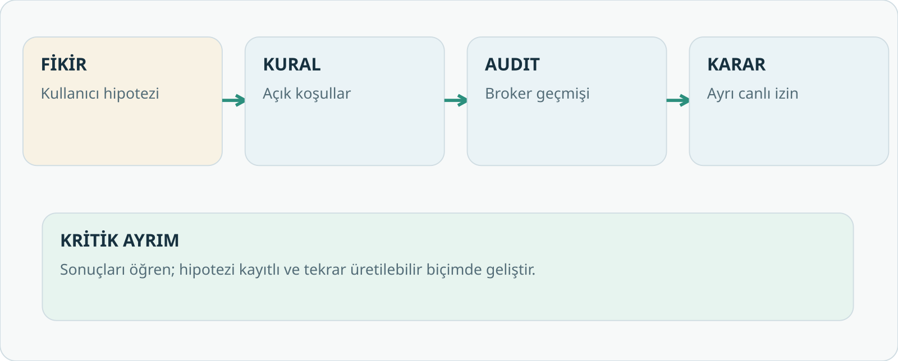

| Kullanıcı ihtiyacı | Sistemin karşılığı | Doğru tanıtım ifadesi |
| --- | --- | --- |
| Bir fikri test etmek | Koşul ve mantık kapılarıyla entry builder | Fikrini açık kurallara dönüştür. |
| Broker verisini kullanmak | Yetkili MT5 terminalinde native audit | Sonucu kendi broker geçmişinde incele. |
| Ne olduğunu anlamak | İşlem satırları, SL/TP, DATA ve maliyet durumu | Sadece yeşil bir sayı değil, işlem izini gör. |
| Kontrolü elde tutmak | Taslak, audit, canlı izin ayrı durumlar | İşlemin ne zaman başlayacağına sen karar ver. |
| Tekrar üretilebilir araştırma | Konfigürasyon/hash, kaydedilen strateji, pencere kayıtları | Aynı ayar paketine dön ve karşılaştır. |

Hedef kitle yalnızca uzman quantlar değildir. Rehberli görünüm, soru işaretli açıklamalar, animasyonlu dersler ve yapay zekâ önerileri başlangıç bariyerini düşürür. Bunlar finansal okuryazarlık, risk bilinci ve veri kalitesi ihtiyacını ortadan kaldırmaz.

**Şirket ve ürün adları**
Çalışma alanı ProTradingSystem; web ürününün arayüz markası STRATUM; yayımlama deposu CemkaCapital. Deck ve videolarda STRATUM ana ürün adı olarak tutarlı kullanılmalı. Binance/BrightFunded tasarım ilhamı, ortaklık veya marka bağlantısı değildir.

Kaynaklar: S01, S05

## Bugünkü sürümün kapsamı

11 Ekim 2026 tarihindeki çalışan dağıtım ile araştırma fikirleri birbirinden ayrılmalıdır.

4 motor ailesi; 191 katalog stratejisi; 1.692 kampanya pencere kaydı

| Alan | Mevcut durum | Sınır / kanıt |
| --- | --- | --- |
| Web yayımlama | GitHub Pages + Supabase Edge | Statik ön yüz; dinamik yetkilendirme/API. Yerel localhost servisine bağımlı üretim yolu değil. |
| Kontrol API'sı | stratum-control v12 ACTIVE | 11 Ekim dağıtım ve HTTPS/hash kontrol kaydı. |
| Tarayıcı oturumu | Yeni login için 7 gün | 168 saat sınırı simüle saatle test edildi; eski oturum kendi eski bitişini korur. |
| Demo erişimi | Tek seferlik 30 gün | Yeniden ZIP indirme süreyi yenilemez. |
| Birleşik MT5 audit | Dört native aile | Dört aile roundtrip testi ve bir ayrıntılı MaCross eşdeğerlik örneği. |
| Ödeme | Üretim uçtan uca ödeme kanıtı yok | Abonelik yetki modeli mevcut; ödeme altyapısı tamamlanmış SaaS gibi sunulmamalı. |
| AI/voice | Öneri, rehberlik, opsiyonel ses | Model/OS/tarayıcı desteği ve maliyetine bağlı; otonom işlem yetkisi yok. |
| L2/L3 gerçek order flow | Mevcut broker verisi bunu kanıtlamıyor | Quote-activity proxy; yürütülmüş alış/satış agresör hacmi değil. |

Web kontrol kataloğunda aileler boyunca 742 input/runtime tanımı bulunuyor: ORB 202, MaCross 210, Sol 119, Entry Lab 211. Bu sayı 742 benzersiz bağımsız işlem fonksiyonu veya 742 ayrı animasyon demek değildir; ortak ayarlar aileler arasında tekrar eder.

**Eski dokümanlara karşı öncelik**
README ve bazı Ekim başı dokümanlarında 'yalnızca local pilot' ifadeleri hâlâ bulunuyor. Yayımlama/oturum için 11 Ekim doğrulaması önceliklidir; eski üretim güvenliği ve ödeme sınırları ise otomatik olarak ortadan kalkmış sayılmaz.

Kaynaklar: S02, S03, S06, S07

## Uçtan uca sistem mimarisi

Tarayıcı konfigürasyon oluşturur; bulut izin verir; yerel yardımcı ile MT5 hesaplar ve uygular.

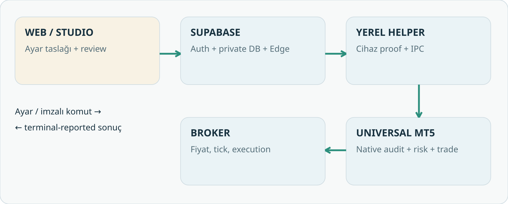

- GitHub Pages: HTML, JavaScript, CSS, fontlar ve kamusal tanıtım varlıkları. MT5 motorunu veya veritabanını çalıştırmaz.
- Supabase Auth + özel Postgres verisi: kimlik, demo/abonelik, cihaz sahipliği, controller nesli, strateji erişimleri, işler ve sonuç kayıtları.
- Edge Function: kimliği/erişimi doğrular, işi ve imzalı native komutu üretir; şirketin özel anahtarlarını tarayıcıya vermez.
- Yerel Node yardımcı: cihaz anahtarıyla istek imzalar; ortak MT5 dosya alanındaki komut/sonuç iletişimini taşır. Açık kalması gerekir.
- UniversalConnectionEA: imza ve bağlam kontrolünden sonra native aile çekirdeğini çalıştırır; chart izlerini ve terminal durumunu üretir.
- Broker: fiyatlar, tick geçmişi, sembol özellikleri, teminat ve emir gerçekleştirme. Web arayüzü broker gerçekleşmesini garanti edemez.

Kaynak paylaşımı kapalı çekirdeği ifşa etmez: istemci keyfi MQL kodu göndermez, doğrulanan veri sözleşmesine uygun bir ayar paketi gönderir. Mevcut dört aileye erişim, ortak abonelik/cihaz yetki zincirinin içinden geçer.

Kaynaklar: S01, S03, S04, S08, E04, E05

## Web arayüzü ve kullanıcı yolculuğu

Ana sayfa anlatır; Studio kurar, test eder ve ayrı canlı onayını yönetir.

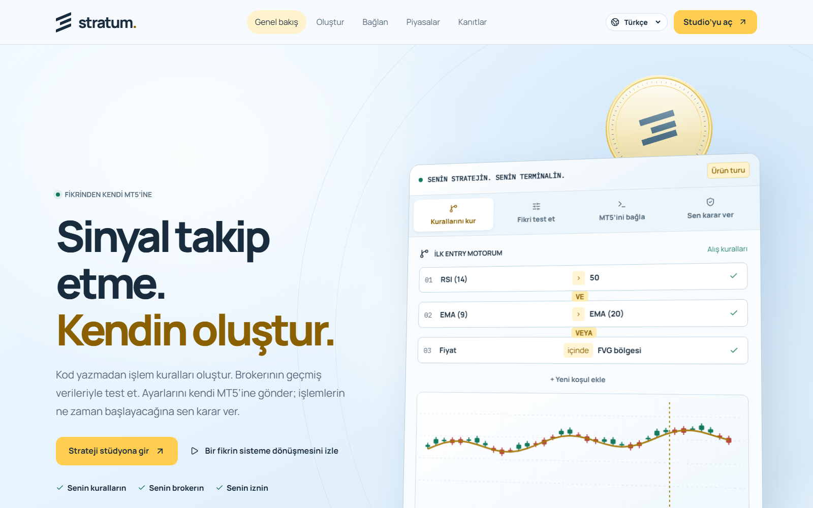

**Görsel kapsamı:** V01 / Mevcut üretim ön yüzünün yerel build görüntüsü. Tanıtım coin'i ve örnek sahneler piyasa sonucu değildir.

- Ana sayfa: fikir oluşturma, kişisel EA bağlantısı, çoklu pazarlar, kontrol odaları ve mühendislik kanıtları üzerinden ürün anlatımı.
- Studio: hesap/demoyu kontrol et → MT5'i eşleştir → motor ve ayarları seç → Uygula ve Audit → sonuç/coverage incele → istenirse ayrı Trading ON incelemesi.
- Rehberli görünüm temel alanları öne çıkarır. Uzman görünümü ayrıntılı NAS, order flow, rejim, risk, saat dilimi ve audit ayarlarını açar; görünüm değişikliği taslak değerlerini değiştirmez.
- Kontrol odaları odaklı modal pencerelerdir. Taslak değişikliği, kaydetme ve MT5'e uygulama farklı işlemlerdir. Modalı açmak işlem yetkisi oluşturmaz.

Core UI'da Türkçe, İngilizce ve Almanca yerleşik dil paketleri kullanılır. Strateji adları, semboller ve teknik kimlikler çevrilmez; bilinmeyen dinamik teknik metinlerde İngilizce fallback olabilir.

Kaynaklar: S01, S05, S09

## Kontrol odaları ve ortak ayarlar

Sinyal, filtre, geometri, risk ve pozisyon yönetimi birbirine karıştırılmadan ayarlanır.

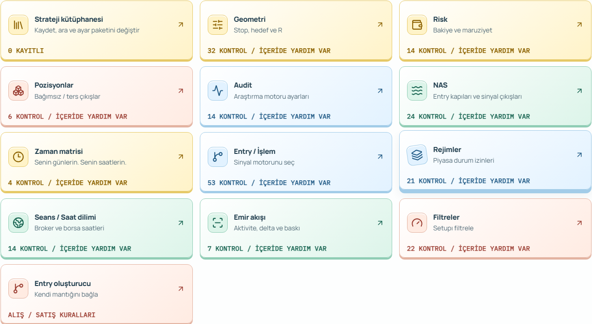

**Görsel kapsamı:** V02 / Gerçek kontrol odası bileşeni; görsel yakalamada yetki vermeyen tanıtım oturumu kullanıldı.

| Oda | Karar | Neyi değiştirmez? |
| --- | --- | --- |
| Entry / Execution | Hangi olay setup üretir? | Tek başına risk bütçesini veya canlı izni belirlemez. |
| Geometry | SL, hedef R, inversion ve tolerans | Hedef R tek başına WR veya para kazancı garantisi değil. |
| Positions | Legacy / Independent, kapasite, reverse exit | Açık broker SL/TP'lerini keyfi olarak sıfırlamaz. |
| NAS / Filters / OF | Setup kabulü ve uygun native çıkışlar | Proxy veriyi gerçek L2/L3 akışına dönüştürmez. |
| Risk | Bakiye, yüzde/para risk, lot ve güvenlik | Fiyat tahmin motoru değildir. |
| Time Matrix / Session | Gün-saat izni ve doğru seans saati | Geçmişte iyi saatler gelecek için garanti değil. |
| Audit | Geçmiş pencere, veri ve hesaplama modu | Apply işlemi otomatik canlı emir açmaz. |

Paketin controls_catalog.json dosyası tüm 742 aile/input/runtime tanımının mevcut tip, varsayılan ve enum seçeneklerini içerir. Bu rapordaki özetle çelişen bir kesin parametre adı için makine-okunur katalog ve ilgili native kaynak esas alınmalıdır.

Kaynaklar: S03, S09, S10

## Dört native motor ailesi

Ortak panel her aileyi tek bir algoritmaya indirgemez; aileye özgü matematik korunur.

| Aile | Setup kaynağı | Native ana dosya |
| --- | --- | --- |
| ORB | Opening range, breakout/retest ve uygun imbalance senaryoları | orb/OrbUltimateEA_StrategyLibrary.mq5 |
| MaCross | MA/state/cross, Trendline, Close/Reverse, scalp ve Trender IQ | macrossover_orb/MaCrossOverOrbEA.mq5 |
| Sol Advanced | ERL/IRL, likidite sweep, FVG ve displacement anlatısı | SolAdvanced/LiqNarrativeSol_Advanced.mq5 |
| Entry Lab | Altı inherited mod + builder tabanlı özel koşullar ve on şablon | entry_engine_lab/EntryEngineLabEA.mq5 |

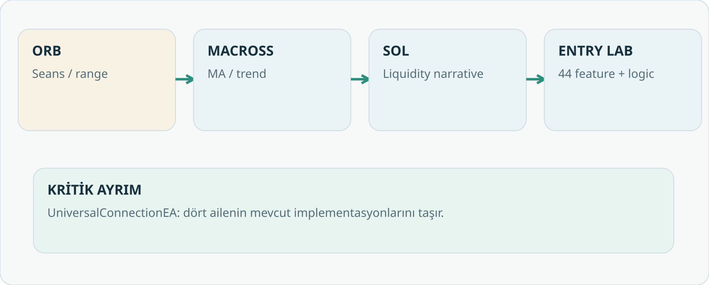

Altı MaCross modu: MA MTF, EMA 50/200, Trendline, Close/Reverse, Scalp arrows ve Trender IQ. 'Close short / go long' metni her modun tek bir ortak sinyali olduğu anlamına gelmez; seçili kernel ve ham yön ile trade yönü ayrı alanlardır.

**Universal çekirdeğinin doğru tanımı**
Tek abone bağlantı EX5'si mevcut implementasyonları barındırır. Abone arayüzü read-only karşılama, abonelik/demo durumu ve bağlantı sağlığı gösterir; history işlem okları ve seviyeleri chart üzerinde çizilir. Dört native dashboard'ın her paneli EX5 üzerinde tekrar açılmaz.

Kaynaklar: S04, S11, S12, S13, S14

## ORB: açılış aralığına dayalı motor

ORB, rastgele saatlerde MA kesişimi aramak yerine, tanımlı seans aralığı ve sonrasındaki fiyat davranışını işler.

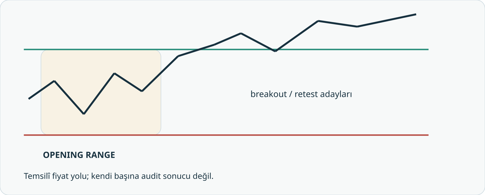

- Seans başlangıcı/bitişi ve işlem sonu, broker/exchange saat dönüşümüne bağlıdır. UTC midnight override ve manuel seans ayarları farklı kullanım senaryolarıdır.
- Sinyal TF'si chart TF'sinden ayrı olabilir; chartın M1 olması motorun her durumda M1 kernel kullandığı anlamına gelmez.
- Breakout, retest ve M1 imbalance seçenekleri; gecikme/confirm bars, minimum breakout, ATR range, displacement, FVG, hacim ve rejim izinleriyle birlikte değerlendirilir.
- SL seçimi ve hedef R, setup tespitinden ayrıdır. Range multiplier ile ilk stop mesafesine göre R aynı birim değildir.
- NEXT DAY EXIT ORB'ye özgü toggle'dır; genel MA REV EXIT aynı şey değildir. Genel reverse etkinse özel next-day kuralına öncelik verir.
- Independent live yürütme için native NAT ON, PUB OFF, hedging ve SINGLE gerekir. Çok bacaklı Independent tek pozisyonmuş gibi raporlanmaz.

Sunumda ORB'yi yalnızca 'New York açılışı botu' diye kısıtlama. Seans saatini doğru broker/exchange saatine dönüştürerek farklı endeks ve piyasa araştırmalarını destekleyen bir aile olarak anlat. Aynı saat hizası farklı broker fiyat/spread geçmişlerinin aynı sonuç vermesini garanti etmez.

Kaynaklar: S11, S15, S03

## Sol Advanced: likidite anlatısı

Sol Advanced, mevcut liquidity-narrative matematiğini koruyan; NAS ve pozisyon kontrolleriyle çevrelenen native ailedir.

- ERL/IRL ve ilgili likidite referansları, seçili yüksek TF/entry TF ve swing yapısı içinde işlenir. FVG, sweep ve displacement seçenekleri setupın bağlamını tanımlar.
- Entry/SL/TP geometrisi, inversion ve regime logic ayrı native kurallar taşır. Bu rapor şirketin özel strateji tariflerini yeniden yayımlamaz veya onları basit RSI kuralına indirgemez.
- NAS Entry/State Gate, Opp/Add Exit, volume alanları, sensitivity, age ve wait; native pozisyon politikası ve strateji serialization içinde yer alır.
- Legacy bir aktif pozisyonu, Independent toplam açık pozisyon sınırını kullanır. Genel reverse exit yalnızca pozisyon açıldıktan sonraki Liq sinyallerini dikkate alır; ORB next-day kuralı eklenmez.
- NAS/Positions ve fixed/custom TARGET R güncellemeleri açık owned pozisyonlarla uygulanabilir. Mevcut ticket koruma politikaları korunur; audit ve yeni girişler yeni ayarları kullanır. Tam strateji değiştirme için flat-instance kuralı ayrıdır.
- Filtreyle elenen setup, belirsiz tarihsel çıkış anlamındaki DATA ile aynı şey değildir. Filtre reddi ne kabul edilmiş trade satırı ne de uydurulmuş loss olmalıdır.

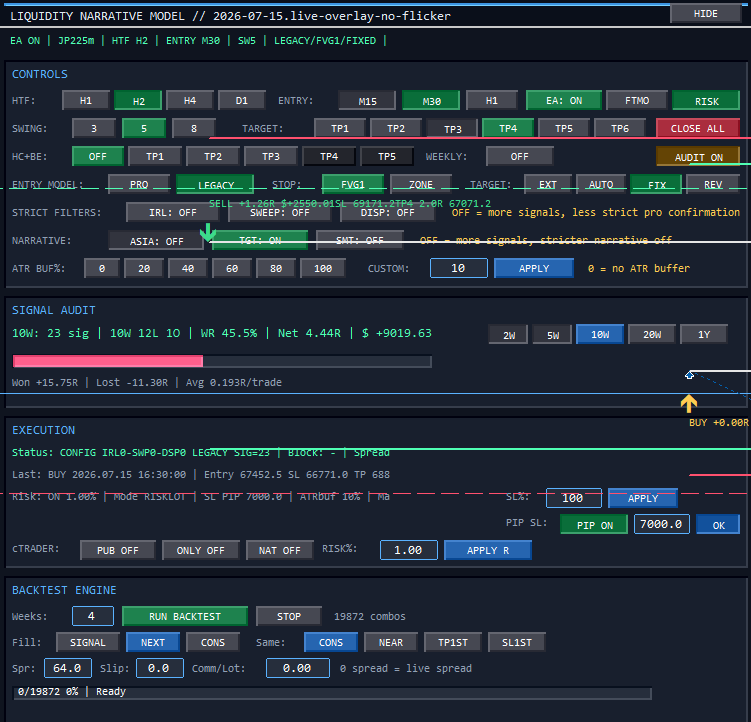

**Görsel kapsamı:** V11 / Temmuz 2026 eski native araştırma ekranı. Ürün geçmişini gösterir; güncel Sol Advanced UI veya MEGA kanıtı değildir.

**Çizim mesajı**
Yeni video kaydında current Sol Advanced chartı tercih et. Eski altı TP butonlu ekranı bugünkü R modalı olarak gösterme. NAS sinyal/exit katmanları ile Liq kabul/red katmanlarını renk ve açıklamayla ayır.

Kaynaklar: S13, S16, S17

## Entry builder: açık mantık sözleşmesi

Kural satırları kod üretmek yerine seçili causal özellikleri, karşılaştırmaları ve mantık kapılarını birleştirir.

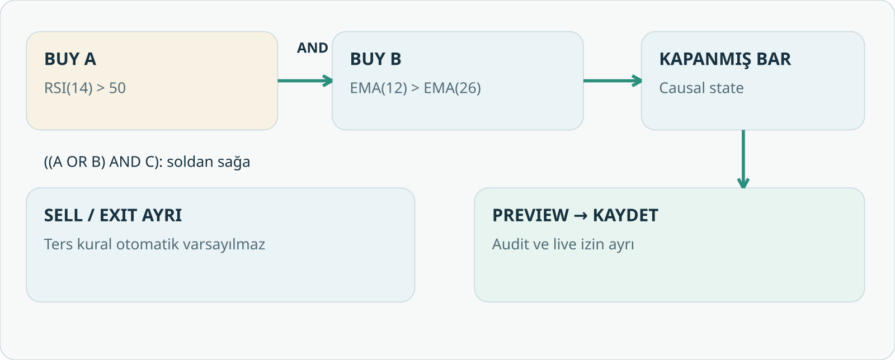

- BUY, SELL, LONG EXIT ve SHORT EXIT listeleri ayrıdır. Alış kuralının satışı otomatik tersine çevirdiği varsayılmamalıdır.
- Bir satır: sol feature/period → comparator → sağ feature/period veya sabit → AND/OR/XOR bağlantısı → opsiyonel NOT.
- Native ifade katlama sırası soldan sağadır: A OR B AND C = ((A OR B) AND C). Matematikteki standart AND önceliği varsayımı burada yanlış sonuç verir.
- Varsayılan tetik false-to-true edge olabilir; EVERY BAR ayrı seçenektir. İki yön aynı anda doğruysa entry üretilmez. NOT, eksik warm-up değerini geçerli doğruya dönüştürmez.
- Parametreli EMA/SMA/RSI/ATR/Wilder ADX/HMA; Bollinger, önceki bar high/low, body/ATR ve stateful FVG gibi açık 44 feature kataloğu kullanılır.
- CSV'deki yüzlerce sütun otomatik olarak builder'a alınmış değildir. Native katalog ile as-of export kataloğu farklı veri sözleşmeleridir.

Web v2 sözleşmesi her yön/exit listesinde en fazla 256 kural, period 1-5000 kabul eder. Native dosyanın daha büyük iç limiti web ürününde sonsuz kural vaadi anlamına gelmez. Preview mevcut filtrelerle audit yapar; kaydetmek ayrı, canlı kullanmak ayrı işlemdir.

Kaynaklar: S03, S14, S18

## On Entry Lab şablonu

Şablonlar builder kurallarıdır; bağımsız on yeni hard-coded kernel veya garanti edilen günlük işlem sayısı değildir.

| # / Şablon | Entry fikri | Cooldown / ek çıkış |
| --- | --- | --- |
| 01 Slow EMA + ADX | EMA12/26, RSI14 >55/<45, ADX14 >22 | 5 mum |
| 02 EMA Pullback | EMA8/21; EMA8'e dokunup geri kapanış; RSI9 | 3 mum |
| 03 RSI 50-Line | SMA50 yönü; RSI7 52 yukarı / 48 aşağı cross | 2 mum; RSI ters bölge exit |
| 04 Fast EMA + RSI | EMA5/13 state; RSI7 >52/<48 | 1 mum; 10 mum hold |
| 05 Bollinger Reversion | BB20/1.5σ dışına taşma, içe kapanış; RSI7 | 1 mum; moving middle-band TP değil |
| 06 Micro-Breakout | Önceki 5 mum high/low dışı close | 1 mum; 8 mum hold |
| 07 EMA/RSI Re-entry | EMA5/12, SMA50, RSI7, ADX7 >12 | 1 mum; 12 elapsed dakika |
| 08 Ultra-Fast EMA | EMA3/8 state, RSI5 >51/<49 | 0; 6 mum / EMA reverse exit |
| 09 Candle Momentum | Candle yönü, EMA20, body >0.2 ATR10 | 0; 4 mum hold |
| 10 Directional Flip | Close/EMA3, RSI3 >50/<50 | 0; 3 mum hold |

Mevcut release'te executable SL/TP, önceki tariflerdeki ATR mesafelerinden değil uygulanan pip SL ve seçili R'den üretilir. ATR period/SL/TP metadatası eski tarifin başlangıç oranını açıklayabilir; bugünkü yürütme geometrisi diye sunulamaz. ATR entry özelliği olmaya devam eder.

**Engine exits anahtarı**
ENGINE EXITS OFF yalnızca LAB_RULE_EXIT ve LAB_TIME_EXIT'i kapatır. SL/TP, NAS, MA reverse ve cooldown etkileri ayrı kalır. Çok kısa hedefler broker stop/tick-size ve spread sınırlarına takılabilir; frekans hedefi fill vaadi değildir.

Şablon seçimi saved kullanıcı motorunu sessizce ezmez. Aynı isimli motor kaydı güncellenebilir; strateji snapshot'ı motor kurallarının kopyasını saklar. Sonradan aynı motoru düzenlemek eski stratejinin snapshot'ını kendiliğinden değiştirmez.

Kaynaklar: S14, S03

## R geometrisi ve gerçek maliyet

R ilk stop riskinin birimidir. Hedef R ile gerçekleşen net R'yi eşit kabul etmek maliyet ve erken çıkışları gizler.

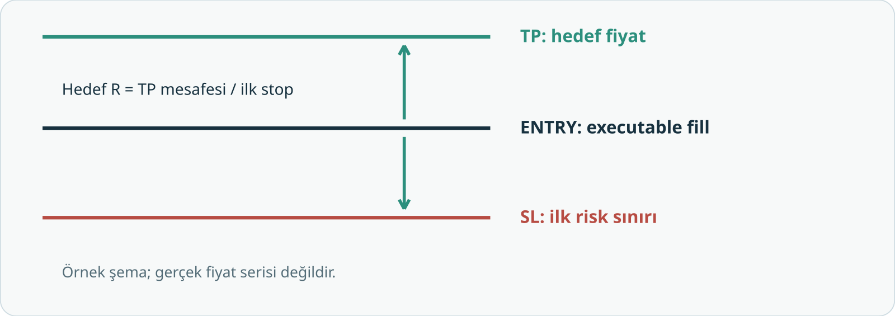

| Terim | Tanım / örnek | Dikkat |
| --- | --- | --- |
| İlk stop mesafesi | |entry - initial SL| | Instrument tick size ve broker şartlarına uygun olmalı. |
| Hedef R | Planlanan TP mesafesi / ilk stop mesafesi | 10 pip SL, 1R hedef: yaklaşık 10 pip TP; fiyat yuvarlama olabilir. |
| Net trade R | Gerçekleşen/modeled signed PnL / başlangıç riski | Geometri, gerçek quote, erken exit ve bilinen maliyetlerden etkilenir. |
| Para riski | Referans sermaye × risk yüzdesi | 30 hesap birimi × %1 = 0.30; lot adımı/min lot gerçek riski değiştirebilir. |
| MinCum | Kümülatif kapalı net R yolunun minimumu | Maksimum peak-to-trough drawdown değildir. |
| Closed drawdown | Kapalı kümülatif net R'nin peak-to-trough kaybı | Açık pozisyonların floating equity drawdown'ı değildir. |

R modalı hazır hedeflerin yanında custom pozitif değer destekler. Native R alanının esnekliği tüm brokerlarda 0.00001R hedefin yerleştirilebilir olması anlamına gelmez. Web sözleşmesi pozitif/finite ve doğrulanan sayısal sınırlar uygular; fiziksel fiyat çözünürlüğü ve broker emir kuralları devam eder.

**Maliyetler veriyle anlatılmalı**
Spread giriş quote'undan, slippage ise ancak gözlenmiş gerçek gerçekleşmeden ölçülebilir. Tarihsel simülasyondaki configured slippage gerçek ölçülmüş slippage diye sunulmaz. Komisyon/swap bilinmiyorsa sıfır olduğu iddia edilmez.

Kaynaklar: S03, S04, S19, E02, E03

## Bakiye, lot, teminat ve cent hesap

Stop mesafesiyle gereken teminat aynı ölçü değildir. Hesaba yatırılacak tutarı yalnızca pip × min lot formülüyle belirlemek doğru değildir.

| Kontrol / gösterge | Ne anlatır? | Operasyonel anlam |
| --- | --- | --- |
| Balance apply / referans sermaye | Risk hesabında kullanılacak sermaye | Fiyat seviyesini değil, hedef lot/risk miktarını değiştirir. |
| Risk % | İlgili sizing modunda sermayenin yüzdesi | Min lot, volume step ve margin nedeniyle tam yüzde gerçekleşmeyebilir. |
| Native fixed-money risk | İsteğe bağlı para riski | Desteklenen NAT path; listener yüzde-risk protokolüyle karıştırılmaz. |
| BUY/SELL teminat | OrderCalcMargin temelli tahmin | Stop mesafesi azalınca aynı minimum lotun teminatı zorunlu olarak azalmaz. |
| Min lot SL kaybı | OrderCalcProfit ile min volume'un stop kaybı | Min lotun stopta kaç hesap birimi kaybedebileceğini gösterir. |
| Account currency | Broker hesabının para birimi | Cent hesapta gösterilen 100 birim, sıradan USD hesabının 100 USD'si varsayılmaz. |
| Account safety | Exposure, daily loss, margin usage, protection | Başka filtreler kapalı olsa bile native güvenlik/uyumluluk kontrolleri etkili olabilir. |

Örnek: 10 pip stopla 0.01 lot için hesaplanan zarar ile 0.01 lotun broker teminatı iki ayrı sayıdır. Stopu 100 pipten 10 pipe indirmek planlanan SL zararını azaltabilir; aynı lotun teminatını 10'da bire indirmesi gerekmez. Kaldıraç, contract size, fiyat, conversion ve broker risk koşulları teminatı etkiler.

**Tanıtım videosunda güvenli gösterim**
Gerçek hesabın login, bakiye ve işlem numaralarını açık gösterme. Demo/örnek hesap birimi belirt. 'Bu tutarı yatır, kesin işlem açılır' veya 'risk %1 her koşulda tam %1' söylemlerini kullanma.

Kaynaklar: S03, S11, S13, S14, E02, E03

## Legacy, Independent ve reverse exit

MAX, güncel istenen davranışta toplam eşzamanlı açık owned native pozisyon sayısıdır; ardışık sinyal veya yön başına ayrı kota değildir.

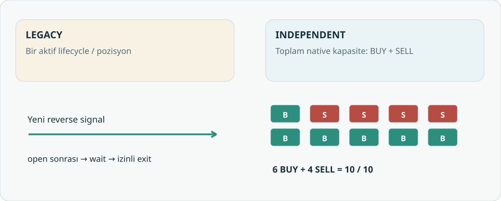

- Legacy: bu instance için bir aktif pozisyon/lifecycle. İkinci giriş, kabul şartları ve mevcut pozisyon kapanışıyla sınırlanır.
- Independent: BUY + SELL toplam açık kapasite. MAX=10 örneğinde 6 BUY + 4 SELL dolu kapasitedir; yeni SELL için yön değişimi kota sıfırlamaz.
- OPEN n/MAX sayacı canlı owned position book'udur. Tarihsel auditin O kaydı, gerçek terminal açık pozisyon sayacı olarak kullanılmamalıdır.
- MA REV EXIT, yalnızca position-open sonrasındaki ilgili ters sinyali kullanır. HH:MM grace sırasında son yön durumu belirleyicidir; aynı yön latch'i iptal edebilir.
- ORB NEXT DAY EXIT ayrıca açılıp kapanır. Sol Advanced'a ORB'ye özgü ertesi gün davranışı eklenmez.
- Native multi-ticket yönetim broker hedging hesabı ister. Netting ve çok bacaklı yürütme destek sınırları görünür olmalı; yeni exitler listenerlara otomatik taşınmış sayılmaz.

Ayar değişimi geçmiş pozisyonların ticket bazlı koruma durumunu yeniden yazmak zorunda değildir. Özellikle Sol NAS/Positions ve hedef güncellemelerinde eski ticketlar kendi broker SL/TP ve exit snapshot'larıyla korunur; yeni audit ve gelecekteki girişler yeni ayarı kullanır. Tam strateji değiştirme veya farklı policy-engine seçimi ayrı flat/uyumluluk korumalarına takılabilir.

Kaynaklar: S11, S12, S13, S14, S16

## Inversion: yön, seviye ve gerçekleşme

Mutlak fiyat seviyelerini ters işleme taşımak, gerçek Bid/Ask piyasasında bütün W/L sonuçlarının zorunlu olarak yer değiştirmesi değildir.

- Ham setup yönü ile uygulanmış trade yönü ayrı tutulur. Normal/inverse aynı aday zamanını referans alabilir; maliyet/coverage/kapasite/filtre kabulü yine farklı olabilir.
- Seviye koruyan inversion niyeti: normal TP, ters SL; normal SL, ters TP. Gerçek trade fiyatı, executable quote ve broker stop şartları bu geometrinin yerleştirilebilirliğini etkiler.
- BUY genellikle Ask ile açılır ve Bid tarafında kapanır; SELL Bid ile açılır ve Ask tarafında kapanır. Chart çoğunlukla Bid mumunu gösterir. Bid'in yeşil çizgiye dokunması SELL'in Ask TP tetiklenmesini tek başına kanıtlamaz.
- Inverse maximum gap/cost tolerance pahalı adayları eleyebilir. Bu gate açıkken toplam trade sayısı azalabilir; aynı örnek kümesi korunuyormuş gibi performans karşılaştırılmaz.
- Çok küçük TP/SL, tick-size rounding ve spread oranının büyümesini sağlar. 1R etiketi gerçek net PnL'nin her işlemde tam +1/-1 olması için garanti değildir.
- Eski bug ekranları bugünkü sürümün kanıtı olarak kullanılmamalı. Seviye/entry/exit kronolojisi, iki quote tarafı ve maliyet kaydıyla doğrulanmalıdır.

**Asla kullanma**
'Kaybeden stratejiyi tersine çevirince garantili kazanan olur', '1R'de W ve L her brokerda tam swap olur' veya 'Ask-proof kesin dönüş sağlar' tanıtım iddiaları bu raporun kanıtlarıyla desteklenmiyor.

Dürüst görsel anlatım: aynı normal/inverse fiyat sınırlarını göster, arada Bid-Ask bandını çiz ve gerçekleşme koşulunu açıklayan ikinci katman ekle. Teknik rapor, bu özel inversion davranışı için tüm stratejileri kapsayan yeni bir saha testi yapıldığını iddia etmez.

Kaynaklar: S03, S04, S19, E01

## NAS: entry kapıları ve exit akışları

'Bu setup'ın yönünü, o anda fiyatın bulunduğu bölge ve aktivite destekliyor mu?' yaklaşımı; sinyal çekirdeğini değiştirmeden kabul katmanı kurar.

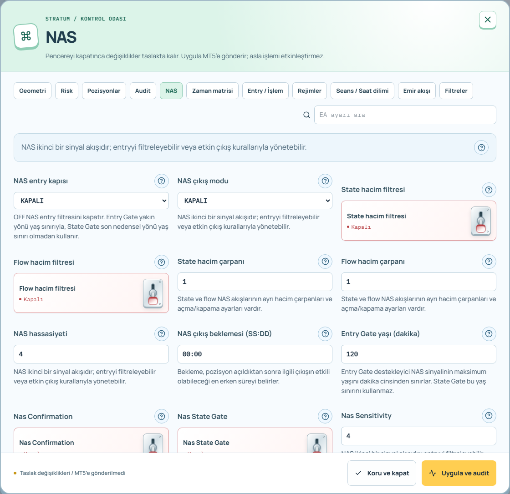

**Görsel kapsamı:** V05 / NAS odası, mevcut üretim bileşeni. Görüntü sırasında filtre uygulanmadı, emir verilmedi.

| Kontrol | Rol | Önemli ayrım |
| --- | --- | --- |
| Entry Gate / State Gate | Entry kabul bağlamı | Kapalı filtre eski kernel matematiğinin yerini almaz. |
| State Vol / multiplier | State kaynağının hacim yeterliliği | Flow Vol ile ortak tek field değildir. |
| Flow Vol / multiplier | Flow/exit kaynağının hacim yeterliliği | Tick-volume gerçek exchange hacmi sayılmaz. |
| Opp Exit / Add Exit | Desteklenen native kapanma şartları | Entry red ile DATA/LOSS aynı şey değil. |
| Sensitivity | NAS sinyal duyarlılığı | Gelecek kazanma olasılığı değildir. |
| Age / lookback | Sinyalin kabul edilebilir yaşı | Entry anından sonraki bilgi geçmiş entry'e uygulanmaz. |
| Wait HH:MM | Exit bekleme süresi | NAS wait ile MA reverse wait iki farklı kontrol olabilir. |

Native chartta entry-gate ve NAS-exit sinyalleri ayrı katmanlarla gösterilebilir; iki akışın aynı yerde oluşması ayrı renk/etiket kullanmayı gerektirir. Liq filtre red okları soluk red açıklamasıyla gösterilebilir. Bu görsel debug işaretleri yeni kabul edilmiş trade satırı oluşturmaz.

Kaynaklar: S09, S13, S16, S17

## Order flow: ölçülen şeyin adı

Mevcut OF çekirdeği broker Bid güncellemelerinden fiyat bölgesi aktivitesi ve yönlü quote hareketi üretir.

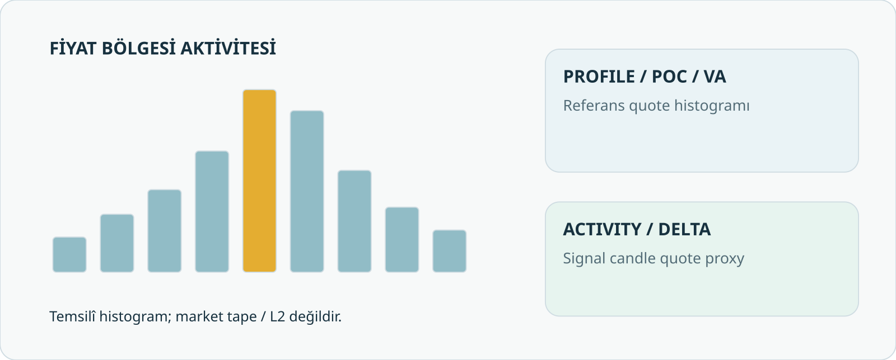

- Referans kapalı mumların Bid güncellemeleri price-bin histogramına girer; POC, VAL ve VAH buradan türetilir. Signal candle referans profilin içine katılmaz.
- Ask-only quote değişimleri alış/satış işlemi gibi sayılmaz. Yukarı/aşağı Bid hareketleri buy/sell proxy; sabit/ilk fiyat neutral sayılır.
- Activity = signal güncelleme sayısı / referans mum başına ortalama güncelleme. Delta proxy = (up - down)/(up + down + neutral).
- Bid-update sayısı ile broker mum tick_volume uyumsuzsa snapshot invalid olur. Yetersiz geçmiş OHLC'den uydurulmuş tam footprint ile doldurulmaz.
- Modlar OFF, breakout, rejection, either, profile-only, activity-only ve delta-only. Birden fazla eşik bir arada kullanıldığında filtre ciddi sayıda setup eleyebilir.
- Mevcut sınırlar: lookback 2-128, bins 4-256, value area 0.1-1, activity 0-100 ve min delta 0-1. Esnek eşikler, doğruluğu kanıtlamadan daha iyi getiri iddiası üretmez.

Profesyonel anlatım 'kurumsal para nerede kesin biliyoruz' değildir. Quote aktivitesinin bölgesel yoğunluğu ve yön uyumunu inceleyen, kaynak sınırlılığı açık bir filtre anlatımıdır. CFD/forex broker tick akışı tüm piyasanın order book'u veya gerçekleşmiş agresör işlem hacmi değildir.

**Performans iddiası yok**
Bu rapor OF'nin NAS'tan daha iyi olduğunu, filtrelenmiş stratejilerin bütün ailelerde iyileştiğini veya yeni bir OF kampanyası yapıldığını iddia etmez. Getiri/retention etkisi config bazlı baseline ve bağımsız dönemle ölçülmelidir.

Kaynaklar: S20, S21, S19, E01

## Broker ve exchange saatleri

GMT/UTC offset bir saat farkıdır; DST ise bu farkın tarihe bağlı değişim kuralıdır.

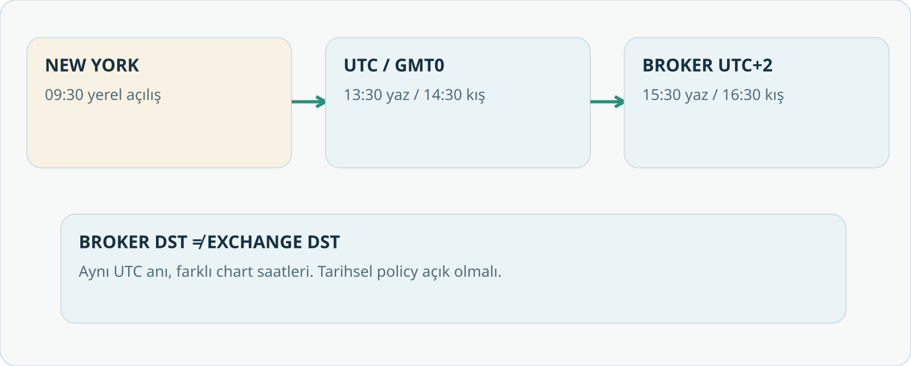

- New York 09:30 nakit açılışı UTC'de ABD yaz saatinde 13:30, standart dönemde 14:30'dur. Sabit GMT0 broker bu iki ayrı chart saatini görür.
- Sabit UTC+2 broker aynı açılışı 15:30/16:30 görür. New-York-close UTC+2/+3 broker, US DST rejimiyle 16:30'da görebilir.
- Japonya/Hong Kong exchange saati kendi içinde modern DST uygulamaz; broker saatini değiştiren bir profile geçilirse chart karşılığı yine kayabilir.
- Broker timezone/profil ve broker season ile exchange season farklı katmanlardır. Auto, force-standard ve force-daylight tarihsel audit anlamını değiştirebilir.
- Kaynakta offset seçenekleri -12 ile +14, 15 dakikalık adımlarla 105 değer içerir. Bu her tarihsel siyasi timezone değişimini kapsayan IANA veritabanı değildir.
- Eski vanilla/GMT0 stratejileri koruma amacıyla Legacy/default davranış ayrıdır; her sürümde installation profile ile kayıtlı strategy timezone önceliği aynı varsayılmamalı, etkin clock fingerprint kontrol edilmelidir.

Video örneği: aynı HK50 açılışı broker A'da 01:00, broker B'de 03:00; iki saat aynı gerçek UTC anını gösterir. 'Opening time'ı elle iki saat kaydırmak yerine broker dönüşüm profilini açıklayın. Brokerın ofis ülkesi server clock politikasını ispatlamaz.

Kaynaklar: S15, S03, S11

## TIME MATRIX: karar ve tanım

Gün, saat ve gün×saat WR görünümü betimleyici bir araştırma katmanıdır; filtre açıkken entry kabulüne bağlanır.

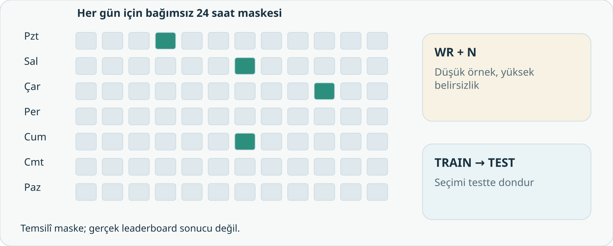

- Yedi gün için bağımsız 24-bit hour mask. Pazartesi 06-07 açıkken salı 13-14 açık olabilir; tek ortak hours listesine indirgenmez.
- DAYS WR, HOURS WR, DAY×HOURS ve leaderboard, seçili pencerenin kabul edilmiş işlem kayıtlarını kullanır. WR = W/(W+L); OPEN/DATA/FLAT kazanma oranına sessizce karıştırılmaz.
- Apply/cancel, tek satır, görünür sayfadaki toplu pick ve WR eşikli smart pick; UI işlemine göre staged seçim ve toplu uygulama olabilir. '96' eşiği gelecek WR garantisi değildir.
- Native HOURS WR satırı etkinleştirmesi ilgili saati bütün günlere ekleyebilir; DAY×HOUR tek kombinasyondur. Gün seçimi ilgili güne özgü saat düzenlemesine gider.
- Giriş kovalaması captured fill time'a; trace yoksa açık available-time fallback'e dayanır. Ailenin calendar_clock alanı broker/session dönüşümünü belirtir; UTC sanılmamalıdır.
- Filtre açıkken kabul edilmeyen aday trade satırına dönüşmez. Günlük kota nedeniyle açılmayan adaylar da leaderboard'a gerçekleşmiş trade gibi yazılmaz.

**İstatistiksel risk**
168 gün-saat kovası, düşük örnek sayısı ve aynı veri üzerinde seçim yüksek overfit riski taşır. MIN N, pencere/clock kaydı ve eğitim dönemi ile untouched test dönemi ayrımı önemlidir. 99/1 ile 9.900/100 aynı %99 WR verir; kanıt gücü aynı değildir.

Kaynaklar: S22, S23, S24, S03

## Günlük sınırlar ve zaman kabulü

Günlük loss/win hedefi yeni girişleri durdurur; geçmişte reddedilmiş adayı açılmış trade gibi göstermez.

| Alan | İşlev | Örnek / sınır |
| --- | --- | --- |
| Daily Max Losses | Seçili gün başladıktan sonraki loss kotası | 0 kapalı; örn. 2 loss sonrası yeni entry durur. |
| Daily Target Wins | Günlük win sayısı hedefi | Örn. 6 win sonrası yeni entry durur; para hedefi değildir. |
| Daily Start HH:MM | Gün sayacının başlangıç sınırı | 00:00 varsayılan olabilir; 12:00 seçilirse takvim gününden farklı bir reset ufku olur. |
| Entry direction | BUY-only / SELL-only / BOTH | Mevcut pozisyon korumasını tek başına kapatmaz. |
| Loss BUY / SELL | Zararların yön dağılımı | Ham signal yönü ile uygulanan inverse yön karıştırılmamalı. |
| Hourly losses | 0-1 ... 23-24 betimleyici loss tablosu | Kendi başına filtre veya yeni entry engine değildir. |

TIME MATRIX ile günlük kota birlikte açıkken bir aday önce mevcut lifecycle/entry kabul koşullarından geçmelidir. Gün 0-1 aralığında kotaya ulaşmışsa daha geç adayların gerçekten açılmadığı belirtilir; bu adaylar saat WR veya export içinde gerçekleşmiş trade sayılmaz. Ölçüler hangi accepted trade setinden üretildiğiyle birlikte gösterilmelidir.

**Sayı hedefinin risk sınırı**
Bir loss ile iki loss'un para etkisi farklı olabilir; günlük loss SAYISI, daily loss MONEY/PCT ile aynı güvenlik ölçüsü değildir. Independent modda aynı günün birden fazla açık pozisyonu varken closure sırası önemlidir.

Strateji yükleme, saved değerleri geri getirmeli; önceki seçilen stratejinin ayarlarını sessizce taşımamalıdır. Varsayılan kapalı filtrelerin varlığı, kullanıcının geçmiş sonuçlarını değiştiren otomatik yeni filtre eklenmesi anlamına gelmez.

Kaynaklar: S03, S22, S23, S24

## Strateji, motor ve sonuç kaydı

Entry engine yalnızca setup üretimi değildir; bir strateji bütün giriş, geometri, filtre, exit, risk ve clock ayarlarını bağlar.

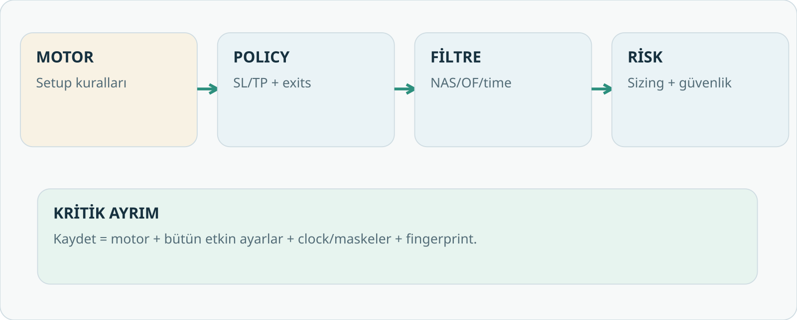

- Native strateji dosyası ile web UniversalConfiguration v2 arasında kontrollü mapping vardır. Family, input/runtime, yedi day-hour mask ve uygun builder snapshot'ı birlikte taşınır.
- Aynı isimle kaydetme update davranışı olabilir; isim bir performans kanıtı veya içerik fingerprint'i değildir.
- Independent/MAX/reverse HH:MM, NAS volume ve yaş, inversion toleransı, timezone ve TIME MATRIX gibi değerler strateji kimliğini etkiler.
- Native katalogda 191 kayıt, web DB karşılığında 191/191 eşleşme raporu vardır. Bu kontrol kaynak konfigürasyonu ve kimliği karşılaştırır; 191 strateji için yeni canlı fill testi değildir.
- Yükleme taslağı değiştirir. Yükleme tek başına audit veya Trading ON başlatmaz. Chart paritesi/sembol bağlamı ve etkin signal TF ayrıca incelenir.
- Native chart TF ve signal TF ayrı olabilir. Strateji ekranında parite/TF/as-of belirtilmesi, kullanıcıya seçili veri bağlamını açık gösterir.

İç kaynak yapısı: her frontier EA'nın kanonik kendi klasörü vardır. Eski root/liq/channel kopyaları geliştirme kaynağı değildir. .mqh bağımlılıkları ilgili ailede tutulur; DEMO Experts dizinine kopyalamak doğrulanmış derlemeden sonra ayrı release adımıdır.

Kaynaklar: S02, S03, S11, S12, S13, S14

## Strateji kütüphanesi ve erişim

Hazır strateji kartı seçili audit penceresinin değerini gösterir; kullanıcı yalnızca adminin açtığı stratejileri görür.

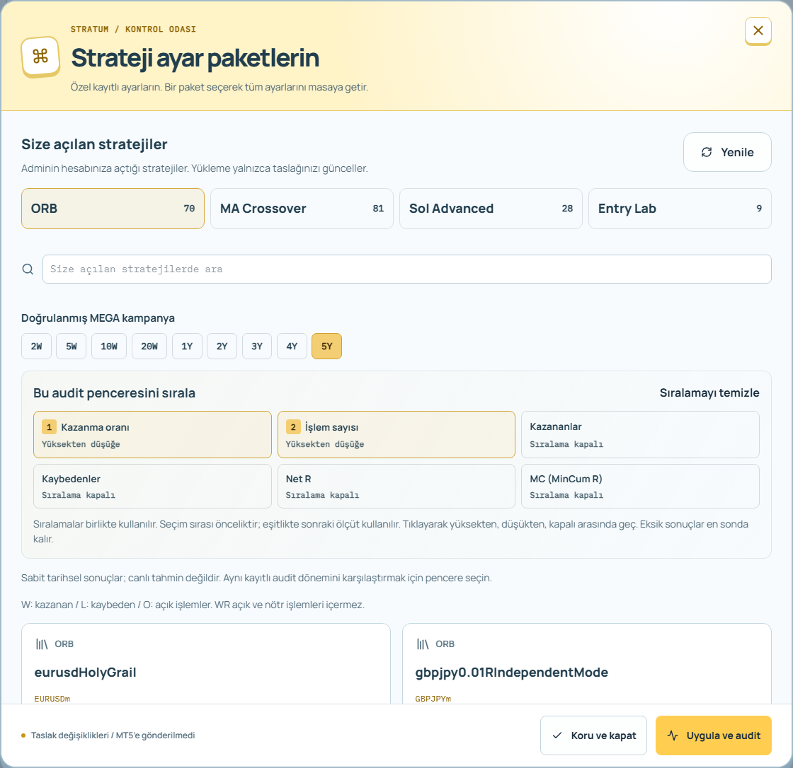

**Görsel kapsamı:** V03 / Gerçek arayüz + doğrulanmış arşiv metrikleri. Görsel kayıtta API taklit edildi; yeni audit veya admin erişimi verilmedi.

- Dokuz pencere: 2W, 5W, 10W, 20W, 1Y, 2Y, 3Y, 4Y, 5Y. Yıllık label bu sözleşmede 52 haftalık katlarıdır; tam takvim yılı varsayılmamalı.
- Sort anahtarları WR, trade count, wins, losses, Net R ve MC/MinCum. Öncelik seçim sırasıdır; ikinci sort birinci sort eşitliklerini çözer. Weighted ortak skor olduğu iddia edilmez.
- En yüksek → en düşük → kapalı çevrimi; missing sonuçlar son sırada. %99 WR eşitliğinde 9.900/100 örneği 99/1'in önüne trade count tie-break ile geçebilir.
- Kart toplam trade, W/L/O, WR, Net R, MinCum, flat, position mode, audit sembol/TF ve broker-time cutoff gösterir. Eksik pencere null/N/A kalır; 0W/0L gibi başarılı audit sayılmaz.

Kaynaklar: S02, S06, S25

## MEGA ve güncel sonuç ayrımı

Bir tarihli kampanya arşivi ile bugünün rolling audit sonucu farklı araştırma sorularını cevaplar.

188 MEGA stratejisi; 1.616 erişilebilir pencere; 76 doğrulanmış unavailable

| Katman | Anlam | Doğru kullanım |
| --- | --- | --- |
| MEGA | Broker-time 2026-10-09 19:46:57 kesitinde mühürlü kayıt | Değiştirmeden referans sakla; sonraki dönemde alpha decay karşılaştır. |
| CURRENT | Bugünün seçili zaman penceresi ve etkin konfigürasyonu | Normal EA audit yolunun aynı endpoint/ayar/clock sonucuyla eşleştir. |
| Rolling refresh | Zaman kaydıkça yeni effective window hesaplama | MT5 worker, broker bağlantısı ve erişilebilir veri ister. |
| Changed fingerprint | Kaynak/strateji kimliği değişmiş | Eski metriği sessizce yeni ayara aitmiş gibi gösterme. |
| Partial coverage | Bazı pencereler available, bazıları değil | Mevcut pencereleri göster; unavailable için nedeni/coverage'i koru. |

Dokuz kayıt olması dokuz başarılı piyasa auditi olduğu anlamına gelmez: 1.692 kayıt içinde 1.616 available, 76 unavailable durum vardır. Üç yeni katalog stratejisinin MEGA kaydı yoktur; uydurulmuş metrikle doldurulmadılar. Web'deki 188 kampanya nesnesi DB'den geri okunup mühürlü kayıtlarla eşleştirildi.

**Sadece 10 günlük delta eklemek neden yetmez?**
Pencere başının kayması, ilk pozisyon durumu, Independent kapasite, günlük quota, cooldown ve path-dependent exits sonraki kabul zincirini değiştirebilir. Rolling sonuç 'eski toplama yeni 10 gün ekle' diye genellenmez; cache/index reuse ile doğru lifecycle yeniden değerlendirilmelidir.

Kaynaklar: S02, S06, S26

## Araştırma başarısı: örnek stratejiler

Olumlu tarihsel örnekleri göster, fakat neden seçildiklerini ve neyi kanıtlamadıklarını saklama.

- orb / 2RModeljp225 / JP225m / M15 / 5Y: 121W, 158L, 64.1917R
- macross / xauusdtrendlineDailyStrategy2R / XAUUSDm / M5 / 5Y: 413W, 707L, 103.2716R
- sol / SolAdvanced_JP225_H2H1_2R / JP225m / M5 / 5Y: 283W, 231L, 167.6832R

Seçim kuralı açık: aile içinde 5Y penceresi available, en az 100 kapalı trade ve Net R >0 olanlar arasından en yüksek Net R. Seçim geriye dönüktür; bağımsız holdout başarısı veya önerilen yatırım ürünü anlamına gelmez. Entry Lab için bu kuralla örnek bulunmadığından yapay bir kazanan eklenmedi.

**WR her şey değildir**
Bu örneklerde WR %50'nin altında olsa bile Net R pozitif olabilir: payoff dağılımı ve exits önemlidir. Tersine çok yüksek WR, düşük hedef R ve maliyetlerle negatif Net R verebilir. 'En iyi WR = en iyi sistem' anlatımı yanlış olur.

MinCum 0 görülen stratejiyi 'drawdown sıfır' diye tanıtma. MinCum, kümülatif net R'nin başlangıç sıfırına göre minimumudur; önce +100R'ye çıkıp +50R'ye düşen bir yolun MinCum'u hâlâ 0 olabilir. Bunlar broker geçmişi ve mevcut audit maliyet semantiği içinde tarihsel araştırma ölçüleridir; çekilebilir nakit gelir tahmini değildir.

Kaynaklar: S02, S06, S27

## Native audit iş akışı

Web'de bir başarı animasyonu göstermek audit çalıştığı anlamına gelmez; terminal sonucu ve coverage geri gelmelidir.

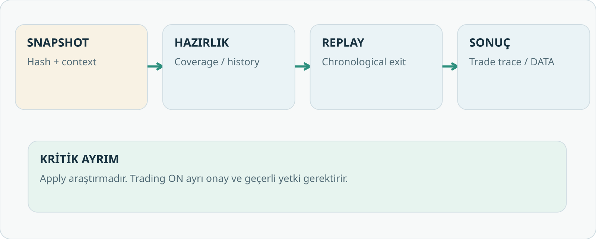

- Request: seçili kurulum, broker/symbol, tam konfigürasyon, endpoint/from-to ve idempotency kimliği. Universal v2 existing_audit_semantics kullanır.
- Hazırlık: signal kernel/bar serisi, indicator state, gerekliyse quote/tick coverage. Chart mumu olması tick geçmişi olduğu anlamına gelmez.
- Replay: aday entry kabulü, geometri, kronolojik tick exits, NAS/reverse/time politikaları, kapasite ve daily quota.
- Aggregation: W/L/FLAT/OPEN/DATA ayrımı, kapalı Net R, WR ve ayrı drawdown tanımı. Belirsizlik loss/win olarak doldurulmaz.
- Transport: config/request hash, build, dataset fingerprint ve kayıtlar geri gelir. Sonuçlar client_reported olarak işaretlenir; bağımsız borsa attestation'ı değildir.
- Chart: oklar ve entry/SL/TP çizgileri native kayıtlardan çizilir. Subscriber çizgileri 1-20 chart barıyla sınırlıdır; büyük auditlerde coordinate kontrolü örneklemeli olabilir.

Karşılaştırmalarda aynı kaynak sürümü, effective input/runtime, chart/signal TF, tarih sınırı, clock policy, broker verisi ve maliyet modu tutulmalıdır. Cache performansı doğruluk karşılaştırmasını sessizce farklı başlangıç state'ine çevirmemelidir.

Kaynaklar: S03, S04, S08, S28

## Tick geçmişi, DATA ve indirme

Candle history, intrabar Bid/Ask gerçekleşme sırasını tek başına kanıtlamaz.

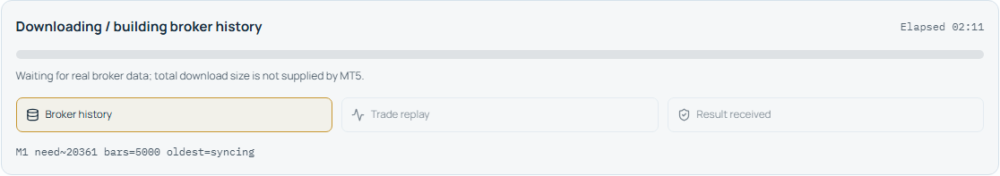

**Görsel kapsamı:** V08 / Üretim progress bileşeninin test görüntüsü. İndirme toplamı broker tarafından verilmediğinde sahte yüzde üretilmez.

| Durum | Anlam | Yapılmaması gereken |
| --- | --- | --- |
| Downloading / building | Gerekli bar/tick kapsamı hazırlanıyor | Toplam byte bilinmiyorken kesin tamamlanma yüzdesi uydurma. |
| Replaying | Bilinen workload işlem adımları ilerliyor | Tüm işlemleri aynı hızda varsayıp SLA garanti etme. |
| OPEN | Seçili son ana kadar kapanış yok | Daha sonra kapanmış canlı pozisyonu geçmiş endpoint'e taşıma. |
| DATA | Kabul edilen kayıt için kesin lifecycle/outcome çözülememiş | OHLC sırasından tam tick PnL uydurma. |
| Filter rejected | Entry kabul edilmedi | DATA veya gerçekleşmiş loss diye sayma. |
| TICK HISTORY UNAVAILABLE | Broker gereken eski quote aralığını sağlamadı | M1 5Y her brokerda mutlaka indirilebilir deme. |

M5'te 5Y gösterilebilen bir strateji M1'de policy/coverage nedeniyle daha kısa geçmişe sahip olabilir. Farkı yalnızca chart TF veya broker yaşı üzerinden kesin açıklamayın; etkin kernel, quote policy ve ilk mevcut tick tarihini kontrol edin. Brokerın saklamadığı ticki yeniden istek atmak yaratmaz.

**MQL5 kaynak sınırı**
CopyTicksRange tarih aralığında tick ister; timeout/partial buffer veya memory hatası mümkündür. Bu API'nin varlığı sonsuz ve eksiksiz broker geçmişi garantisi değildir. Kaynak: resmi MQL5 CopyTicksRange dokümantasyonu.

Kaynaklar: S04, S14, S28, E01

## Audit hızlandırması: ölçüm ve yöntem

Ölçülen ağır yeniden hesaplama işlerinde 4-5× hedefini aşan sonuçlar var; her broker/pencere ve ilk download için aynı hız vaadi yok.

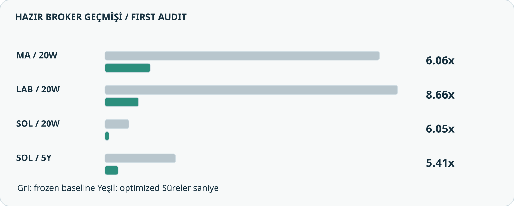

| İş / first audit | Önce → sonra | Hızlanma |
| --- | --- | --- |
| MaCross XAUUSD M1 / 20W | 149.563 s → 24.671 s | 6.06× |
| Entry Lab builtin XAUUSD M1 / 20W | 159.453 s → 18.422 s | 8.66× |
| Sol USDJPY H1 / 20W | 13.140 s → 2.172 s | 6.05× |
| Sol USDJPY H1 / 5Y | 38.453 s → 7.109 s | 5.41× |

Koşullar: broker history ve mevcut V2 day index hazır; first audit cold outcome cache demektir, first-ever download değildir. Entry Lab ölçümü inherited Close/Reverse builtin'dir; on özel builder presetinin hepsi değil. Orb için bu kampanyada bağımsız tam-session süre benchmark'ı yoktur.

MaCross unchanged repeat eski sürümde zaten cached idi: final gözlem 0.282 s → 1.172 s, daha yavaş. Bu satır gizlenmemeli; her cache hit 4× hızlandı denmemeli. Değişen hedef yeniden hesaplaması MaCross'ta 5.13×, Entry Lab'da 7.30× olarak kaydedildi.

**Doğru mod anlatımı**
Orb/MaCross/Entry Lab shared quote batching, mevcut ADV ayarıyla çalışır; legacy/default referans yolu aynı bırakıldı. Sol kendi tick-replay yolunda hızlandı. 'Hem default hem ADV her yerde 8×' iddiası desteklenmiyor.

Kaynaklar: S29

## Cache hız kazandırırken neyi korur?

Hız kazancı fiyat matematiğini değiştirmekten değil, gereksiz quote okumalarını ve güvenli biçimde atlanabilir aralıkları azaltmaktan gelir.

- Shared ADV candidate-minute okuması exact quote cache'in zero-copy slice'larını kullanır; yaklaşık dört saatlik bulk read/bounded extension ile yinelenen çağrılar azalır. Başarısız bulk original exact-range path'e döner.
- Completed day pages için bounded ownership-swap cache. Mutable current day kalıcı immutable page gibi saklanmaz; reset/mode değişimleri uygun cache'i temizler.
- Sol completed altı saatlik quote pages ve exact Bid/Ask extrema proof. SL/TP/HC eventinin olamayacağı kanıtlanan aralık atlanır; aday aralık original kronolojik tick loop'una döner.
- NAS predecessor/successor lookup'ı chronological index kullanır; yaș/bekleme/yön sınırı değişmez. Entry Lab outcome key'inde engine identity eşleştirme hatası düzeltilmiştir.
- Memory limit dolması execution doğruluğunu değil cache retention'ı sınırlar. Server/symbol/tick-size/backfill/sync değişiklikleri invalidation nedenidir.
- Büyük pencere sonucundan küçüğü göstermek, path-dependent state'i doğru yeniden kurma şartına bağlıdır. Konfigürasyon değişince eski trade toplamını kopyalamak geçerli cache hit değildir.

14.177 eşleşen trade trace; 270.115 regression kontrolü; 0 bu testlerde fark

Frozen source ile byte-for-byte kronolojik trace paritesi: entry fill, geometri, exit timestamp, W/L/O/DATA ve R alanları karşılaştırıldı. Bu regression kanıtı eski engine'in tüm varsayımlarının kusursuz olduğunu veya broker live fill'lerinin aynı olacağını matematiksel olarak kanıtlamaz.

Kaynaklar: S29

## CSV: trade başına causal özellikler

Özellik çıkarımı normal audit üzerinde değil, kullanıcı EXPORT AUDIT CSV isteğini verdiğinde çalışır.

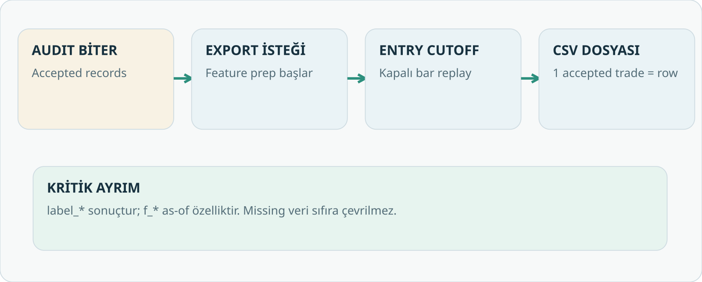

- Her kabul edilmiş audit trade kaydı bir satır: closed, OPEN ve auditin tuttuğu DATA dahil. Kapasite/quota/filtreyle reddedilen adaylar ekstra trade satırı değildir.
- Cutoff captured entry time; yoksa available-time fallback ve entry_time_basis limitation. bar_open + TF_seconds <= cutoff koşulu gelecekteki candle bilgisini engeller.
- label_* alanları sonuç/exit/holding/PnL tanısıdır; prediction feature matrix'ine alınmamalıdır. setting_* alanları ayar snapshot'ı; f_* alanları girişte mevcut özelliklerdir.
- Core OHLC/indicator, rolling returns/moments, MTF state, source-derived Kıvanç ailesi, signal context, regime ve cache'de mevcut NAS/OF durumları birlikte taşınır.
- Missing history/buffer/warm-up blank/status kalır. Slippage ölçümü tarihsel simülasyonda NOT_MEASURED olarak boş bırakılır; configured cost bağımsız gerçek maliyet ölçümü gibi anlatılmaz.
- UTF-8 quoted CSV, .partial → .csv tamamlanması, export progress ve audit değişince iptal. Normal audit sonucu/PnL yeniden yazılmaz.

**Dosya konumu**
Native export: Terminal Common Data / Files / AuditExports. Windows'ta çoğunlukla %APPDATA%/MetaQuotes/Terminal/Common/Files/AuditExports. Tam adres terminal mesajı/tooltip'te görünür. Web ZIP indirmesi ile audit CSV export aynı mekanizma değildir.

30 Eylül doğrulanan şema: ORB 1.292, MaCross 1.308, Sol Advanced 1.200 sütun. Bunlar bağımsız prediction feature sayısı değildir. Yeni release/Entry Lab için aynı sayıyı körlemesine tekrarlama; export header/family schema kontrolü gerekir. Bu rapor yeni production export koşturmadı.

Kaynaklar: S19, S23, S24, S30

## Kaynak türevi ve araştırma özellikleri

Bir indikatorün yalnızca son çizgisi değil, state, slope, event age, channel position ve ara serileri de araştırma özelliği olabilir.

| Kaynak ailesi | Özellik türü | Causal / veri uyarısı |
| --- | --- | --- |
| AlphaTrend / QQE / Laguerre | Raw/filtered events, RSI band state, recursive stages | Kaynak warm-up ve alternating-event kuralı korunmalı. |
| OTT / HOTT-LOTT / Stochastic OTT | VAR/VIDYA, trailing stops, lagged lines | Kaynak [2] gecikmesi kaldırılmaz. |
| Mavilim / Tillson T3 / MOST | WMA/EMA chain, line slope, price crosses | Default VAR MACD standart EMA MACD diye değiştirilmez. |
| SuperTrend / RSX / pivots | Bands, direction, confirmed levels | Pivot onayı gecikmesi causal; mutable ZigZag geleceği yok. |
| Turtle / TwinRange / TrendMagic | Channel levels, event age, state runs | Foreign-symbol screener listesi mevcut chart feature'i değil. |
| Quant rolling / MTF | Semideviation, skew/kurtosis, autocorrelation, entropy, efficiency | Kapanmış bar ve cutoff; training transforms yalnız train'de fit. |
| Literatür adayları | Bipower/jump share, permutation entropy, variance ratio, signatures | Adaylar belge/deney tasarımı; henüz uygulanmış feature gibi sunma. |

24 yerel Pine dosyası için önceki inceleme manifesti tam-source review ve SHA-256 kayıtlarını içeriyor. Bu rapor onları yeniden tek tek denetlediğini iddia etmez; tarihli çeviri doğrulamasını ve mevcut source-derived modülü kaynak gösterir. Review tüm TradingView yayınlarının incelendiği anlamına gelmez.

30 Eylül fixture'ında 517 f_kiv_* alanı; 30 denklem ailesinde 21.000 karşılaştırma ve sıfır fark raporlandı. Bu aynı sentetik OHLC üzerinde çeviri/seed kontrolüdür; TradingView ile broker feed eşitliği veya piyasa alpha kanıtı değildir. Kaynak lisans/atıf koşulları ayrıca korunmalıdır.

**Haber ve ileri model planı**
Ekonomik takvim/haberler, dış news CSV ve JEV/RLCD benzeri pivotlar bu üründe doğrulanmış mevcut yetenek olarak gösterilmemeli. Causal yayın zamanı, timezone ve revisyon provenance çözülmeden dataset'e katılmış sayılmaz.

Kaynaklar: S19, S23, S24, S30, S31

## ML araştırması ve bilimsel disiplin

Feature zenginliği yalnızca modeli büyütme gerekçesi değildir; veri sızıntısı ve çoklu seçim riskini büyütür.

- Mevcut ORB araştırma yaklaşımı: setup generator korunur, stratejiye bağlı veto modeli değerlendirilir. Alternatif ML modelleri yeni sinyal çekirdeğiymiş gibi aktarılmaz.
- Tarihsel trade rows, source/config/data fingerprint ile bağlanır. Feature cutoff ile outcome label ayrıdır; exit time/net R/gelecek excursion giriş verisi değildir.
- Dokümante deney: chronological development/validation/test, exit-overlap purge ve zaman ayrımı, expanding folds, küçük model/tuning bütçesi.
- Lojistik regresyon, küçük MLP ve shallow histogram boosting baseline karşılaştırması; threshold validation'da, final test kilitli. Başarısız kalite koşulu REJECTED olmalıdır.
- TIME MATRIX winner selection veya yüzlerce strategy taraması da model selection'dır. Aynı final test üzerinde tekrar tekrar seçim bağımsız doğrulama değildir.
- BIST/üniversite iş birliği anlatısı araştırma vizyonudur. Resmî imzalı ortaklık, onaylı program kabulü veya Borsa İstanbul canlı veri entegrasyonu bu raporla kanıtlanmış değildir.

**Tanıtım mesajı**
'Araştırmayı tekrar üretilebilir, kayıtlı ve veri kapsamı açık hale getiriyoruz' savunulabilir. 'AI hangi trade'in kazanacağını bilir' veya 'bu kolonlarla kesin yüksek alpha' savunulamaz.

Bir yıllık geliştirme ve geniş deney birikimi güçlü hikâyedir; fakat gerçek akademik katkı hipotez, karşılaştırmalı deney, belirsizlik/negative result raporu ve kaynak/konfigürasyon provenance ile gösterilmelidir. İç engineering test sayısı bağımsız hakemli makale sonucu değildir.

Kaynaklar: S31, S32, S19, S22

## Kimlik, abonelik ve cihaz yetkisi

Login, demo/abonelik, cihaz onayı, controller yetkisi ve canlı trade izni farklı katmanlardır.

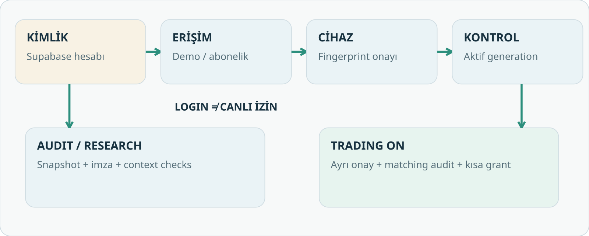

- Hesap: Supabase Auth kimliği; private DB owner/entitlement kayıtları. Demo bir kez 30 gün, yeni ZIP ile sıfırlanmaz.
- Cihaz: Ed25519 public-key fingerprint onayı ve installation sahibi. Yazılım anahtarı anakart/TPM non-exportable attestation değildir.
- Controller: hesap başına aktif generation; yeni kontrol eski agent/controller'ı fence eder. Aynı hesaptaki eşzamanlı yetkili kullanım sıradan dosya paylaşımıyla çoğaltılamaz.
- Komut: server RSA-2048/SHA-256 imzası; public pin EX5 içinde. Installation/account login/broker/symbol/expiry ve increasing sequence doğrulanır.
- Yerel IPC: HMAC ile dosya/sonuç iletişimi. Yerelde okunabilen key tek başına audit/live yetkisi vermez; client_reported result bağımsız doğruluk sertifikası değildir.
- Canlı: tamamlanmış matching audit + açık Trading ON + geçerli owner/entitlement + kısa ömürlü grants. Browser timeout ile login süresi, native execution grant süresi aynı şey değildir.

Yeni login 7 günlük BFF oturumu verir; Supabase access/refresh tokenlar server-side şifreli kalır. Cloud tarayıcı opaque bearer handle'ı saklar; bu handle'ın varlığı abonelik veya canlı izin yerine geçmez. XSS/session-handle koruması ve private server key yönetimi hâlâ kritik güvenlik alanıdır.

Kaynaklar: S07, S08, S33, S34, E05, E06

## Kesintisiz kullanım ve fail-closed

Kullanıcıdan sürekli yeniden onay istemeden çalışmak; internet yokken sınırsız yeni entry açmak demek değildir.

| Olay | Yeni giriş / araştırma | Mevcut koruma |
| --- | --- | --- |
| Tarayıcı kapandı / BFF süresi bitti | Önceden verilmiş live consent, device proof ve entitlement ile yenilenebilir | Broker-held SL/TP ayrı kalır. |
| Trading OFF / logout | Yeni yetki durur; verilen kısa grant kendi deadline'ına kadar yaşayabilir | Mevcut pozisyon zorunlu anlık tasfiye edilmez. |
| Helper kapandı / network loss | Kısa ömürlü native yetki sona erer; yeni entry fail-closed | Broker koruma emirleri terminal UI'dan bağımsızdır. |
| Helper yeniden açıldı | Aynı onaylı config/consent uygun koşullarda devam edebilir | Yeni login/audit her restartta zorunlu değil. |
| Device revoked / entitlement expired | Yeni grant reddedilir | Mevcut native/protective yönetim ayrı policy kapsamındadır. |
| Broker/account/symbol değişti | Önceki bağlamın yetkisi taşınmaz; iş/Trading OFF | Yeni bağlam yeniden doğrulanmalı. |

Mevcut device agent lease yaklaşık 15 saniye, native command grant en fazla 15 saniye, controller/research lease daha farklı süredir. Önemli güvenlik mesajı: '7 gün oturum' = '7 gün çevrimdışı trading bileti' değildir. Revocation sıfır gecikmeli uzaktan durdurma garantisi de değildir.

118 policy/auth kontrolü; 167 simüle saatlik yenileme; 168 saat sınırında red

11 Ekim kontrolünde gerçek EX5 ile ORB JP225m M5/2W: 5W, 3L, DATA0, +2R. Algo Trading kapalı kaldı; live broker order açılmadı. Bulut continuity testi ayrı unattached QA kurulum ve etiketli fixture sonucu kullandı. Bunlar canlı kârlılık veya yedi gün fiziksel bekleme testi değildir.

Kaynaklar: S07, S08, S33

## Kişisel EX5 aktivasyonu: sekiz adım

Yeni kullanıcı hesabından broker chartına kadar iş akışı; yalnızca bir pairing kodu yapıştırmaktan ibaret değildir.

| Adım | Kullanıcının yapacağı | Başarı kontrolü |
| --- | --- | --- |
| 1. Hesap | Kayıt, e-posta onayı, login | Ad + DEMO/kalan gün veya ACTIVE. |
| 2. ZIP | Kişisel EA'yı indir; yazılabilir özel klasöre çıkar | MQL5, helper/connection ve BAT mevcut. Node 22.13+. |
| 3. Helper | start_connection.bat çalıştır, açık tut | Pairing code, fingerprint ve .state/connection.set yolu. |
| 4. Pair | Aynı hesapta kodu gir, fingerprint'i karşılaştır/onayla | Cihaz approved; broker şifresi istenmez. |
| 5. MT5 dosyaları | File → Open Data Folder; MQL5 içeriklerini kur | Experts/StratumUniversal ve OF worker doğru yerde. |
| 6. Attach | UniversalConnectionEA'yı chartta aç; Inputs → Load | Bu ZIP/kurulumun .state/connection.set'i; greeting/DEMO. |
| 7. Browser authorize | Onaylı installation ID'yi seç, tarayıcıyı yetkilendir | CONNECTED + bu browser yetkili; helper/MT5 çalışıyor. |
| 8. İlk audit | Trading OFF iken kısa 2W pencere Apply | Gerçek sonuç veya açık data/error; ardından ayrı live review. |

**Süreler ve sırlar**
Unused setup ticket 30 dakika; pairing code 5 dakika. Demo 30 gün ve login 7 gün bunlardan ayrıdır. Pairing code, fingerprint, .state private keys ve download ticket video kaydında maskelenmeli; izleyiciye kendi kodunu kullanması söylenmeli.

Yeni ZIP yeni kurulum oluşturabilir; aynı hesapta eski approved cihaz bulunması baştan pairing'i yasaklamaz. Eski .state aynen taşınırsa yeni cihaz demosu değil resume olur. Tam tutorial için eski helperı durdur, temiz klasörde yeni ZIP aç, yeni preset'i kullan. Controller değişimi eski aktif agent'ı fence edebilir.

Kaynaklar: S35, S36, S08, S07

## Kurulum ekranı ve sorun giderme

Kullanıcı aynı ZIP, helper ve preset zincirini takip etmelidir; dosya kopyalama tek başına yetkilendirme değildir.

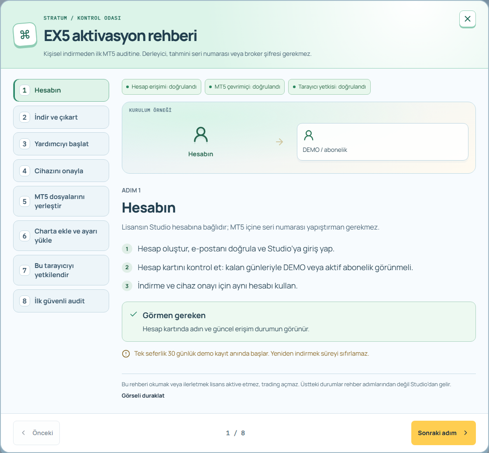

**Görsel kapsamı:** V07 / Mevcut aktivasyon modalı. Kimlik/bağlantı göstergeleri tanıtım fixture'ıdır; canlı pairing yapılmadı.

| Mesaj / durum | Olası sebep | İzlenecek kontrol |
| --- | --- | --- |
| PAIRING_EXPIRED_OR_UNKNOWN | Kod süresi, farklı backend/kurulum veya eski helper | Aynı hesap/endpoint; güncel helper çıktısı; expired ise yeni kurulum bileti. |
| Device already approved | Aynı .state/installation yeniden kullanılmış | Onaylı cihazı seç; controller authorize ve matching preset. |
| ATTACH_CONNECTION_EA | Helper var, native chart heartbeat yok | Doğru MT5 data folder, EX5/worker, chart ve Inputs installation ID. |
| CLOUD_SERVICE_UNAVAILABLE | Cloud/network geçici kesinti | Kaydedilmiş oturum korunabilir; retry, backend/bağlantı sağlığını incele. |
| AUDIT_AUTHORITY_EXPIRED | Lease/command yenilemesi veya helper/API gecikmesi | Helper/MT5 erişimi ve uygun güncel package; başarılı sonucu otomatik varsayma. |
| TICK HISTORY UNAVAILABLE | Broker gerekli geçmişi sağlamadı | Requested start ile first available tick/engine diagnostic; daha kısa pencere. |

Filmde pending/spinner ve açıklayıcı durumları göster; boş 30 dakika bekleme kaydını başarıya çevirmeyin. Troubleshooting ayrı kısa bölümde olmalı. Teknik IDs kamu videosunda maskeleme; başka kullanıcının .state dosyasıyla eşleşmeye çalışmama vurgusu önemli.

Kaynaklar: S35, S36, S28, S07

## Robot rehber: uzman öneri, sınırlı yetki

AI kullanıcı niyetini ayar önerisine çevirebilir; işlem kararını gizlice ele alamaz.

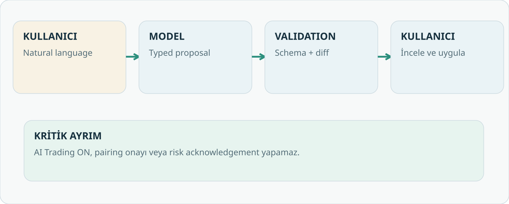

| Tool | İzinli etki | Sınır |
| --- | --- | --- |
| edit_settings / select_engine | Gözden geçirilebilir config önerisi | Family değişimi reset; requested target aynı öneride taşınmalı. |
| load_strategy / save_strategy | İzinli kayıtları yükleme/kaydetme önerisi | Başka kullanıcının katalog/key/DB erişimi yok. |
| run_audit | Kullanıcı onayıyla native audit isteği | Gerçek olmayan sonuç üretme veya tek başına Trading ON yok. |
| show_controls | İlgili oda/builder/library gezinimi | Parametreyi sessizce değiştirmez. |
| review_trading | Mevcut canlı onay ekranını açar | Risk checkbox veya confirm trading action'ı agent yapamaz. |

Server ve browser strict schemas; unknown control/enum, malformed minutes, stale draft, excessive/duplicate calls reddedilir. Konuşmada 'uyguladım' demek gerçek UI apply değildir. Öneri preview'i tam taslak, timeframe, R, engine, exits ve değişiklik farkını gösterir; kullanıcı son incelemeyi yapar.

**R tanımında kritik doğruluk**
0.10R hedef, ilk stop riskinin 0.10 katı hedef demektir. Otomatik olarak ORB range'in %10'u demek değildir. Açılış family değişimi sırasında 1R default'u bırakıp sözle 0.10R uygulanmış demek yanlış yönlendirmedir.

Kaynaklar: S37, S38, S03, S09

## Öğreten animasyon, ses ve chat history

Sevimli robot bir marka yüzü olabilir; animasyonu yapay zekânın gerçekten düşündüğünü veya piyasa sonucunu kanıtlamaz.

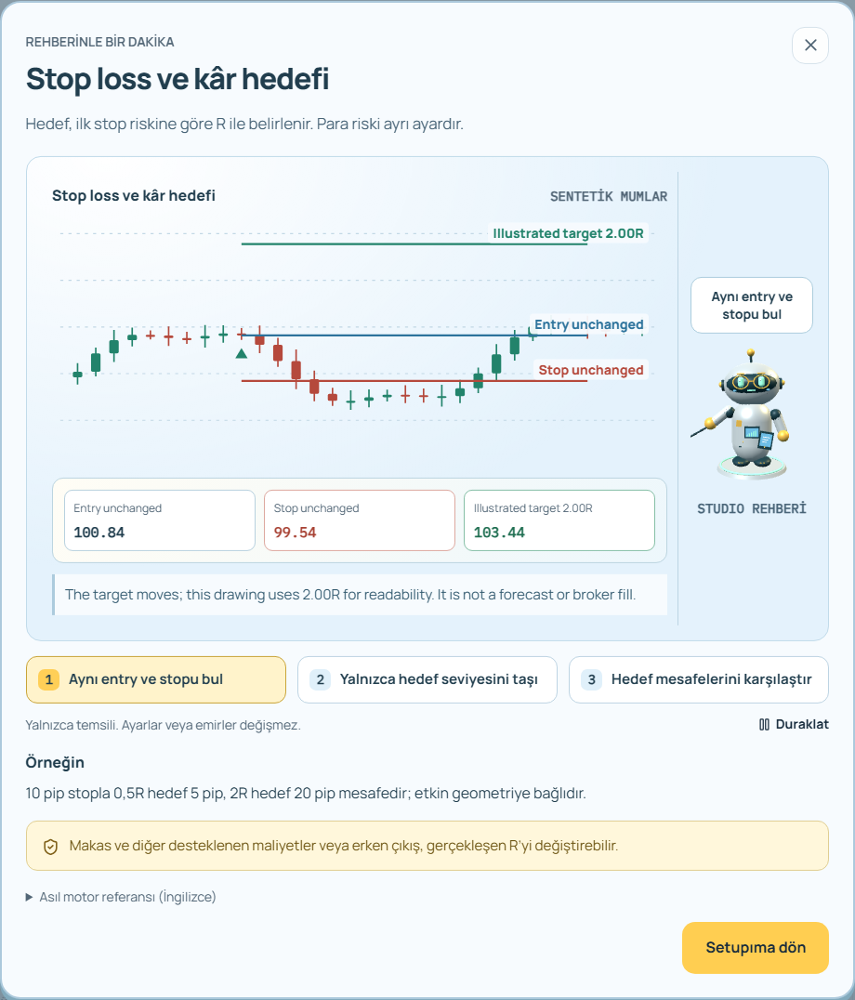

**Görsel kapsamı:** V06 / Sentetik eğitim mumları; robotun açıklayan pose'u. Parametrelerin gerçek piyasa simülatörü değildir.

- Göz kırpma, idle bakış, listening/nod, hand-on-chin thinking, curious gaze ve board pointing yerel UI state'ine bağlıdır. WebGL fallback/reduced motion vardır.
- 25 teaching-effect ailesi, current/default parametre ve üç adımlı mum sahnesiyle etkiyi anlatır. 742 birbirinden bağımsız tam motor simülasyonu olduğu iddia edilmez.
- Voice varsayılan OFF; açık mic consent ve kullanıcı başlatması. Varsayılan dikte önce text box'a düşer; kritik pip/R sayıları kontrol edilir. Browser ASR dış sağlayıcı kullanabilir.
- Ağız hareketi speech synthesis start/end ve varsa boundary events'e bağlıdır; gerçek phoneme/viseme lip-sync değildir.
- Konuşmayı kaydet isteğe bağlıdır. Kayıtlar kullanıcı sahibiyle ilişkilidir; kaydedilmiş sohbet yüklemek config veya trading yetkisini kendiliğinden restore etmez.
- OpenRouter öncelikli; local Qwen/Ollama opsiyoneldir. Model kalitesi, kredi, rate limit ve erişilebilirlik değişir; yerel model tüm ses işinin de yerel olduğu anlamına gelmez.

Kaynaklar: S38, S39

## Native EA ile birleşik EA eşdeğerliği

Bağımsız baseline native EA ile subscriber EX5 aynı seçili stratejinin kayıtlarını karşılaştırdı.

41 eşleşen trade satırı; 25 / 15 / 1 W / L / O; 0 geometri/zaman farkı

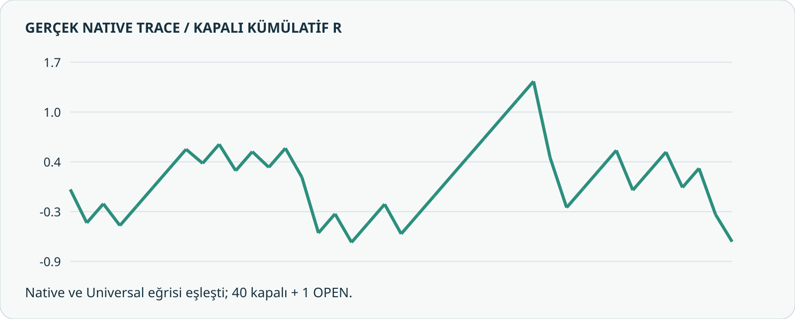

Örnek: MaCross jp225Close/Reverse0.25R, JP225m; 21 Eylül 2026 00:00 - 5 Ekim 2026 00:00 UTC. Baseline unmodified canonical source, kendi strategy loader ve historical audit yoluyla üretildi; universal baseline'ı kendi adaptöründen üretmedi.

| Ölçü | Native baseline | Universal EX5 |
| --- | --- | --- |
| W / L / O / DATA | 25 / 15 / 1 / 0 | 25 / 15 / 1 / 0 |
| Net R | -0.685166666666 | -0.685166666666 |
| Closed drawdown R | 2.102166666667 | 2.102166666667 |
| WR | %62.5 | %62.5 |
| Trade chronology / prices | Aynı 41 kayıt | Fark listesi boş; numeric tolerance 1e-10 |

**Kanıtın kapsamı**
TP025 ile TP_R0.25000000 etiket alias'ı ayrı kaydedildi; fiyat/zaman/PnL alanını muaf tutmadı. Bu seçili preset için parite kanıtıdır; tüm 191 strateji veya gerçek broker fill paritesi değildir. Negatif sonucu pozitif reklam rakamına çevirmiyoruz.

Kaynaklar: S40, S08

## Dört aile roundtrip ve güvenlik testleri

API → helper → native EX5 → sonuç → chart zinciri gerçek native testte çalıştırıldı; broker order açılmadı.

| Aile / roundtrip | W / L / O / DATA | Net R / süre |
| --- | --- | --- |
| ORB | 7 / 2 / 0 / 0 | +5R / 8.101 s |
| MaCross | 55 / 74 / 0 / 0 | -19R / 47.491 s |
| Sol Advanced | 4 / 6 / 0 / 0 | -2R / 10.108 s |
| Entry Lab | 956 / 1191 / 1 / 0 | -235R / 125.331 s |

Bu değerler kontrollü native entegrasyon iş yükleridir; kampanyadan seçilmiş şampiyon stratejiler değildir. Bu tabloyu tanıtım kazanç tablosu olarak kullanmayın. Gerçek native result files JP225m bağlamını kaydeder; her örneğin request/config'i korunur.

- Roundtrip raporunda compile: 0 error / 0 warning. Server-signed yetki, wrong key, replay/expired grant, old controller, helper-loss ve revoke durumları kontrol edildi.
- Chart kanıtı: ORB 9, MaCross 129, Sol 10, Entry Lab 2.148 kayıt çizildi. Büyük auditlerde en fazla 64 coordinate örneği; tüm chart piksel/koordinatlarının exhaustive doğrulaması iddia edilmez.
- Katalog testi: 191/191 native/web mapping; 188/188 campaign object readback exact. 35 catalogue/campaign/security test PASS kaydı mevcut.
- 11 Ekim auth/continuity: 118 test; gerçek EX5 helper stop/restart ve yedi günlük simüle login sınırı. Yerel ve bulut fixture testlerinin kapsamı ayrı etiketli.

**Önemli sınır**
Testte coverageComplete true, transportta realTicks=0 raporlanması exact tick kullanılmadı diye otomatik yorumlanmaz; existing_audit mode aktarımda tick sayısını ölçmüyor olabilir. Ancak bu alanı milyonlarca doğrulanmış real tick sayısı diye reklama çevirmek de yanlıştır.

Kaynaklar: S07, S08, S28, S40, S41, S02

## Yayımlama ve üretim sınırları

Canlı site yayımlanmış olması, bağımsız güvenlik incelemesi ve kesintisiz ödeme operasyonunun tamamlandığı anlamına gelmez.

| Alan | Mevcut sınır | Tanıtım / release kuralı |
| --- | --- | --- |
| Sonuç aktarımı | En çok 10.000 trade / HTTP payload limitleri | Yüksek frekanslı multi-year sonucu sınırsız gösterme vaadi yok; oversize görünür fail. |
| Cihaz lisansı | Software private key; EX5 patching mümkün | Anakart/TPM garantisi, kırılamaz lisans iddiası yok. |
| Sonuç güveni | client_reported | Kötü niyetli istemcinin sonuçları bağımsız doğrulanmış borsa kaydı sayılmaz. |
| Canlı broker execution | Bu rapordaki testler Algo Trading OFF | Slippage, fill, stop/freeze ve roundtrip canlı execution SLA kanıtı yok. |
| Ödeme ve operasyon | Üretim billing/webhook kanıtı yok | Ödeme, backup restore, key rotation, monitoring ve incident işlemleri release kapsamı. |
| Auth hardening | Önceki raporda leaked-password koruması kapalı | Bağımsız security review/hardening tamamlandı diye sunulmaz. |
| Tutorial | Synthetic effect families | Şirket proprietary logic ve exact broker audit yerine geçmez. |
| AI önerileri | Schema-valid olabilir, ekonomik olarak kötü olabilir | Agent uzmanlık hissi bir finansal uygunluk sertifikası değildir. |

Supabase default-deny/owner scope ve admin grants önemlidir. Admin rolü client user_metadata içinde yazan 'admin=true' ile kazanılmaz. Hazır strateji grant'i kapatmak sonraki list/load erişimini engeller; daha önce kullanıcıya verilmiş bir konfigürasyonu onun bilgisayarından sihirli biçimde geri alamaz.

**Dışarıya açık cümle**
Geçmiş veya simüle performans gelecek getiriyi garanti etmez. Trading risk taşır. STRATUM bu kanıt paketinde yatırım tavsiyesi veya kâr garantisi sunmaz; kullanıcı ve broker yürütme bağlamı esastır.

Kaynaklar: S04, S08, S02, S06, S42, E06

## Tanıtım için iddia ve kanıt tablosu

Bir cümleye kanıt kartı bağlanamıyorsa kesin teknik veya finansal iddia olarak kullanma.

| Kullanılabilir ifade | Kanıt | Eklenmesi gereken sınır |
| --- | --- | --- |
| Dört motor ailesi tek bağlantı üzerinden | Universal kaynak/roundtrip | Her strateji için exhaustive parite değil. |
| Kural tabanlı BUY/SELL builder | Native 44 feature + web v2 rules | Sınırsız feature/derinlik veya proprietary ORB/Sol tarifini paylaşma değil. |
| 191 kayıtlı katalog stratejisi | Native/web mapping 191/191 | Kullanıcı adminin açtıklarını görür; üçünde MEGA yok. |
| 188 strateji, dokuz kampanya penceresi | 1.692 durum kaydı | 1.616 available; 76 unavailable. |
| Ölçülen yeniden hesaplamalarda 5-8× hız | 3 Ekim frozen/optimized timing | Hazır geçmiş; workload örnekleri; bütün işler aynı değil. |
| 14.177 trade trace eşleşti | Exact acceleration regression | Eski motoru referansla eşlemek kusursuz market truth değil. |
| 41 işlemde native/universal eşdeğerlik | MaCross JP225m seçili preset | Bir kontrollü örnek; live execution garantisi yok. |
| 7 günlük login, ayrı canlı yetki | 118 auth/policy test | Yeni login; kısa grants; geçerli erişim/helper/MT5 gerekir. |
| Tarihsel pozitif strateji örnekleri | Donmuş MEGA değerleri | Geriye dönük seçilmiş, forward/holdout başarı vaadi değil. |

**Yasak / desteklenmeyen sloganlar**
Kâr garantisi; risksiz; bütün brokerlarda 5Y exact M1; L2/L3 smart-money detector; kırılamaz lisans; hiçbir bug yok; yüzde yüz live/backtest aynı; mutlak inversion; 742 bağımsız simülatör; Borsa İstanbul resmî ortağımız. Bunların kanıtı bu pakette yok.

Daha güçlü ve dürüst alternatif: 'Fikrini kur. Kendi broker geçmişinde test et. İşlem izini gör. Yetkiyi sen ver.' Başarıyı yalnız W/L değil; doğru provenance, coverage, tekrar üretim, işlem trace paritesi ve ölçülen araştırma süresiyle anlatın.

Kaynaklar: S02, S07, S29, S40, S41

## Görsel dil ve düzen şablonları

Parlak araştırma stüdyosu, koyu native chart ve altın aksanı aynı ürün ailesine bağla; her kutuya ayrı stil icat etme.

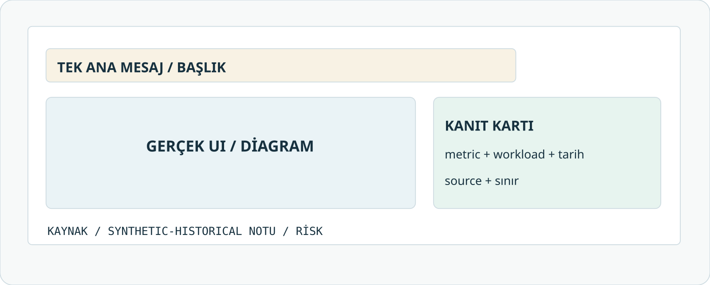

| Öğe | Önerilen kural | Dosya / kullanım |
| --- | --- | --- |
| Renk | Ink #17313F; gold #E4AD31; ice #EAF3F6; mint #2C8F7D | style_tokens.json; aynı palette tut. |
| Başlık | Kısa, güçlü; bir sahnede tek ana fikir | 16:9 deck'te 36-44 pt; body 22-26 pt. |
| Sayısal kanıt | Büyük değer + koşul + kaynak + tarih | Tek başına '8×' değil: hangi audit, veri hazır mı? |
| UI screenshot | Kendi oranında; okunacak kontrolü close-up göster | Stretch yapma, dashboard minik yazı duvarına dönüşmesin. |
| Diagram | 4-6 düğüm; açık oklar ve trust sınırı | SVG kaynakları düzenlenebilir; screenshot üstüne rastgele ok değil. |
| Motion | 180-280 ms UI pop; 450-700 ms diagram reveal | Mühendislik cümlesini dikkat dağıtan loop ile örtme. |
| Footer | Kaynak/tarih, historical/synthetic etiketi | Risk notu final frame ve finansal sonuç karesinde. |
| Ses | Net uzman ton; sakin ama canlı | Kazanç rakamında casino/confetti efekti kullanma. |

Tasarım önerileri üretim UI'sına yeni özellik eklenmiş gibi sunulmaz. SVG storyboard çerçeveleri içerik yerleşim şablonudur; uygulamadaki gerçek ekranlar PNG varlıklarıdır. DeckCraft'ta editlenebilir metin/şekil kullan; her slaytı tek flatten PNG yapma.

Kaynaklar: 

## DeckCraft: 14 slaytlık ana sunum

12-15 dakikalık ürün ve mühendislik sunumu. Her slayt bir iddia, bir görsel ve bir kanıt sınırı taşır.

| Slayt | Başlık / ana mesaj | Görsel / kanıt |
| --- | --- | --- |
| 01 | Fikrinden sistemine: STRATUM | Hero, product loop, kısa research mesajı. |
| 02 | Problem: fikir var, tekrar üretim zor | Teknik kokpit → odaklı oda şablonu; kullanıcı akışı. |
| 03 | Web + senin MT5'in | Architecture SVG; cloud izin/native hesap ayrımı. |
| 04 | Dört aile, tek bağlantı | Family bundle; ORB/Ma/Sol/Lab rol tablosu. |
| 05 | Kural oluşturma özgürlüğü | Builder diagram; BUY/SELL ayrı; 44 feature. |
| 06 | Geometri, risk, exits senin kontrolünde | Geometry + Positions; pip/risk % ayrımı. |
| 07 | Setup bağlamını ölç | NAS ve quote-proxy OF; L2/L3 olmadığını küçük notla. |
| 08 | Ne zaman trade edeceğini belirle | Time Matrix SVG; seçili pencere + MIN N. |
| 09 | Sonucu parçala, yalnız WR'ye bakma | Gerçek MEGA örnek tablosu; retrospective seçimi yaz. |
| 10 | Hızlı research, değişmeyen trace | Benchmark SVG; hazır geçmiş ve workload notu. |
| 11 | Güven zinciri kullanıcıya bağlı | Authority SVG; tek controller ve kısa grant. |
| 12 | Native ile subscriber sonucu eşleşiyor mu? | 41-trade parity curve/table; kapsamı açık. |
| 13 | İlk auditin sekiz adımı | Activation screenshot + 8-step checklist. |
| 14 | Test et, anla, kararını ver | Live review ayrı; çağrı: demo research workspace. |

**Deck teslimat şartı**
Düzenlenebilir native DeckCraft proje + PPTX + PDF önizleme. Her slaytta source ID speaker note'a yazılsın. 16:9; hiçbir metin kadraj taşması, 20 pt altına kaçan ana body veya sahte live veri olmasın.

Önerilen açılış: 'Bir fikrin var. Peki o fikir hangi koşulda işlem olacak, nasıl test edilecek ve ne zaman duracak? STRATUM bu soruları görünür kurallara ve kendi MT5 terminalindeki ölçülebilir sonuçlara bağlar.'

Kaynaklar: S02, S29, S40

## FilmCraft: 90 saniyelik tanıtım

Amaç: teknoloji gösterisi değil, izleyicinin kendi fikrini araştırma sistemine çevirebileceğini anlaması.

| Timecode | Görüntü / motion | Voiceover / ekran metni |
| --- | --- | --- |
| 00:00-00:08 | Hero: coin/orbit kısa reveal; builder node'a match-cut | Bir sinyali takip etmek zorunda değilsin. Kendi kurallarını kur. |
| 00:08-00:19 | BUY ve SELL koşulları; AND kapısı; kısa yakın plan | Giriş koşullarını ayrı yaz. Fiyatı, indikatörü ve bağlamı birleştir. |
| 00:19-00:30 | Kontrol odası; pip SL, R ve total MAX odak | Risk, stop, hedef ve pozisyon sınırı senin kontrolünde. |
| 00:30-00:42 | Web→Supabase→helper→MT5 diagram reveal | Ayarların yetkili terminaline gider. Audit, broker geçmişin üzerinde MT5'te çalışır. |
| 00:42-00:54 | Audit progress; trade trace yakın plan; DATA etiketi | Sadece yeşil sayı değil. Ne zaman açıldı, nasıl kapandı, hangi veri eksik gör. |
| 00:54-01:05 | 149.56→24.67 s benchmark; source footnote | Ölçülen 20 haftalık MaCross testinde yeniden hesaplama yaklaşık altı kat hızlandı. Geçmiş veri hazırdı. |
| 01:05-01:16 | Time Matrix + gerçek kampanya kartı | Zaman pencerelerini karşılaştır. Yüksek WR kadar örnek sayısını ve Net R'yi incele. |
| 01:16-01:25 | Pair/authority; robot explaining; Trading OFF | Araştırma ve canlı izin ayrıdır. İşlem yalnız açık onayınla başlar. |
| 01:25-01:30 | Logo + site + risk notu, motion sakinleşir | Fikrini kur. Test et. Kararını sen ver. STRATUM. |

Format: 1920×1080 30 fps ana video; ayrıca 1080×1920 versiyonda bağımsız layout/reframe, panelleri körlemesine crop etme. Native chartı okumak için 4-6 saniyelik hold ve 125-160% edit close-up kullanılabilir. Bunlar screenshot manipülasyonu değil editte görünür büyütmedir; sayı/etiket değiştirilemez.

**Ses / altyazı**
Ana voiceover Türkçe; İngilizce/Almanca için ayrı onaylı çeviri ve altyazı. Finansal sonuç sahnesinde historical/simulated notu. Lisanslı müzik, görünür click sesleri, tutarlı audio gain; yüksek sesli kâr confetti'si yok.

Kaynaklar: S29, S02

## FilmCraft: 8 dakikalık kurulum videosu

Tutorial'ın başarı kriteri güzel montage değil, izleyicinin doğru cihaz/preset ve Trading OFF ile ilk audit almasıdır.

| Bölüm / süre | Kayıt | Öğrenme / kontrol |
| --- | --- | --- |
| 00:00-00:40 | Web login + DEMO kalan gün | Login, entitlement ve cihaz onayı farklı. |
| 00:40-01:20 | ZIP indir, extract; Node gereksinimi | BAT'ı ZIP içinden çalıştırma; özel klasör. |
| 01:20-02:00 | BAT/helper penceresi | Açık tut; code/fingerprint/preset yolu maskeli. |
| 02:00-02:45 | Browser pair review/onay | Aynı hesap, fingerprint karşılaştırma, 5 dakika. |
| 02:45-03:30 | MT5 File → Open Data Folder | Program files değil gerçek data folder; MQL5 içeriği. |
| 03:30-04:15 | EA attach + .state/connection.set load | Yeni kurulumun installation ID/preset'i; DEMO/connection status. |
| 04:15-05:00 | Browser kurulum seçimi/authorize | Cihaz approved ile controller authorized farklı. |
| 05:00-06:30 | 2W setup Apply; progress ve sonuç | Audit araştırmadır; açık/kapalı/DATA kayıtları, quote coverage. |
| 06:30-07:20 | Robot yardım ve saved setup | Öneri ile uygulanmış ayar ayrımı; konuşma kaydı opsiyonel. |
| 07:20-08:00 | Live review ekranı, OFF kalır | Gerçek hesap/risk kontrolü olmadan Trading ON onaylama. |

**Çekim öncesi checklist**
Tek helper ve doğru terminal. Trading OFF. Diğer users/device config yok. Yeni kurulum gösterilecekse eski .state kopyalama. Ticket/code maskeli. Bildirimleri kapat. Native result ekranında source/date/coverage görünür. Live confirm'e basma.

Hata kliplerini ayrı 60-90 saniyelik kısa videolar olarak çıkar: 'Device already approved', 'attach bekleniyor', 'history unavailable', 'download hazır linki' ve 'helperı kapatınca ne olur'. Her klip tek sorunu çözer; hızlı kesmelerle gerekli kontrol adımını atlamaz.

Kaynaklar: S35, S36, S07, S08

## Yeniden kullanılabilir sahne şablonları

Şablonlar editlenebilir SVG olarak pakette bulunur; içerik yerleşimini korurken farklı gerçek ekranlarla yeniden kullanılabilir.

| Şablon / asset | Alanlar | Ne zaman kullanılır? |
| --- | --- | --- |
| T01_evidence_card.svg | İddia, büyük metric, workload, tarih, source, limit | Benchmark, parite veya catalogue sayılarını anlatırken. |
| T02_ui_walkthrough.svg | Screenshot alanı, 1-3 callout, kullanıcı aksiyonu, başarı kontrolü | Activation ve audit tutorial. |
| T03_trust_boundary.svg | Browser/cloud/local/broker lane; signed arrows | Auth ve connection mimarisi. |
| T04_before_after.svg | Baseline/optimized değer; aynı config checklist | Hız veya filtre experiment; fake profitability değil. |
| T05_strategy_evidence.svg | Name, family, symbol/TF, window/as-of, W/L/O, Net R | Tarihsel örnek; seçilme kuralı ve sample N görünür. |
| T06_error_clinic.svg | Mesaj, sebep hipotezi, kontrol adımı, unresolved state | History ve pairing troubleshooting. |

FilmCraft katmanları: BG, UI_MAIN, FOCUS_FRAME, CALLOUT_01..03, SOURCE_FOOTNOTE, RISK_NOTE, CAPTIONS, VOICEOVER ve MUSIC. DeckCraft shape/text layer adları aynı varlık kimliklerine bağlanır. Logo/coin yalnız görsel marka katmanıdır; hareketli fiyat veya canlı market data iması üretmemeli.

**Agentın teslim raporu**
Kullandığı bütün kaynak/görsel ID'leri, içeriğe eklediği herhangi yeni iddiayı ve gerçek/sentetik ekran ayrımını teslimde belirtmeli. Render edilmiş bütün slayt ve video frame'lerini kadraj/okunabilirlik için doğrulamalı.

Kaynaklar: 

## Diğer agentlara hazır görev metinleri

Bu metinler paketi doğrudan DeckCraft/FilmCraft üretim görevine çevirmek için kullanılabilir.

**DeckCraft agent brief**
STRATUM teknik referans PDF'sini ve HIZLI_BAGLAM.md dosyasını oku. 14 slayt planını uygula; düzenlenebilir native sunum, PPTX ve PDF üret. assets altındaki gerçek UI PNG'leri ile SVG şemalarını kullan. Kanıt sayıları evidence_summary.json ve kaynak tablosuna bağlı kalsın. Kâr garantisi, mutlak inversion, sınırsız L2/L3 veya full production security iddiası ekleme. Eski native screenshot ve sentetik lesson'ı açık etiketle. Kaynak IDs speaker notes'ta. 16:9, büyük okunabilir yazı; bütün slaytları render ederek taşma kontrolü yap.

**FilmCraft agent brief**
90 saniyelik promo ve 8 dakikalık kurulum tutorial'ını ayrı editlenebilir projeler olarak hazırla. PDF'nin shot/timecode planını kullan; UI screenshot metriklerini değiştirme. Video tanıtım metni ve ekran alanları kullanıcıya 'fikir → kural → MT5 audit → ayrı canlı izin' yolunu anlatsın. Historical/synthetic sınırlarını ve broker-history koşullarını belirt. Özel .state, ticket, code, fingerprint ve hesap bilgisini açık gösterme. Trading ON'a basmadan live-review aşamasını öğret. 1080p ana output ve düzgün reframe dikey kısa versiyon; licensed audio, altyazı, kaynak listesi ve render doğrulaması teslim et.

İnternet bağlantısı veya gerçek demo hesabı yoksa mevcut PNG/diagram kayıtlarıyla labeled walkthrough üret. Yeni canlı ekran kaydı yaptığını, gerçek audit çalıştırdığını veya native engine formüllerini satır satır yeniden doğruladığını söyleme. Görsel kaydı elde edememek sahte bir sonuç üretmek için gerekçe değildir.

Paket paylaşımı iç teknik/üretim amaçlıdır. Yayına verilecek deck/video için özel kaynak yollarını ve güvenlik uygulama ayrıntılarını çıkar; public iddia/kanıt kartları ve güvenli ekranlar yeterlidir. Şirketin proprietary source veya tam strateji tarifleri bu pakette dağıtılmaz.

Kaynaklar: 

## Terimler ve okunabilir açıklamalar

Teknik kelimeyi küçültmek yerine ilk kullanımında neyi ölçtüğünü anlat.

| Terim | Kullanıcı için açıklama |
| --- | --- |
| Entry engine | İşlem adayının ne zaman oluşacağını belirleyen kurallar. |
| Strategy snapshot | Motor, filtre, geometri, risk ve zaman ayarlarının kaydedilmiş tam paketi. |
| Audit / backtest | Aynı kurallar geçmişte çalışsaydı kayıtlı veriyle ne olacağını hesaplama. |
| R | İlk stop riskine göre ölçülen trade getirisi/zararı; hesap para birimi değil. |
| WR / W / L / O / DATA | Kapalı win oranı / win / loss / açık / çözülememiş veri durumu. |
| MC / MinCum | Kapalı net R kümülatif yolunun minimumu; maximum drawdown ile aynı değil. |
| Spread / Bid / Ask | Alış-satış quote farkı; iki farklı executable fiyat tarafı. |
| Pip / point / tick size | Instrument fiyat adımları; birbirine her sembolde eşit değil. |
| Hedging / netting | Aynı sembolde ayrı ticketlar / tek net pozisyon hesap yaklaşımı. |
| Legacy / Independent | Tek lifecycle / toplam kapasiteyle ayrı açık pozisyon yönetimi. |
| NAS / OF | Yardımcı state/flow filtresi / quote aktivitesi proxy filtresi. |
| FVG / sweep / displacement | Fiyat boşluğu, likidite seviyesi taşması, belirgin yön hareketi bağlamları. |
| Timezone / DST | Saat farkı / tarihe bağlı yaz saati değişim rejimi. |
| As-of / cutoff | Sonucun veya özelliğin hangi zamana kadar bilgi içerdiği. |
| Client reported | Sonuç kullanıcının terminalinden gelmiştir; bağımsız market attestation değildir. |
| Fingerprint / generation / lease | Cihaz anahtar kimliği / aktif kontrol nesli / süreli yetki. |
| Synthetic illustration | Öğretmek için oluşturulmuş mum/sahne; gerçek piyasa sonucu değildir. |

Sunum anlatımı için teknik bir terimi ilk kez kullandığında tek cümlelik kullanıcı karşılığı ver. Örneğin 'ADV quote batching' yerine önce 'aynı geçmiş fiyatı tekrar tekrar okumayı azaltıyoruz' de; sonra teknik kanıt katmanına geç.

Kaynaklar: S03, S04, S08, S19, S22

## Kaynaklar

- S01 / Ürün ve web konumlandırması / `web-mvp/components/launch-page.tsx`
- S02 / 191 katalog / 188 kampanya doğrulaması / `reports/admin_campaign/VERIFICATION.md`
- S03 / Universal v2 input/runtime/builder sözleşmesi / `web-mvp/lib/universal-contract.ts`
- S04 / Result/trade/coverage ve summarize sözleşmesi / `web-mvp/lib/control-contract.ts`
- S05 / Ana sayfa görünümü ve current sunum metni / `web-mvp/components/launch-page.tsx`
- S06 / DB readback ve katalog metrik karşılaştırması / `reports/admin_campaign/final-db-verification.json`
- S07 / 11 Ekim canlı oturum/yetki dağıtım doğrulaması / `reports/session_continuity_20261011/verification.md`
- S08 / Native auth zinciri ve test sınırları (eski deploy bölümü güncel değil) / `web-mvp/docs/MT5_AUTHORIZATION_VERIFICATION.md`
- S09 / Studio kontrol odaları, apply, result ve review / `web-mvp/components/universal-dashboard.tsx`
- S10 / 742 input/runtime definition kataloğu / `web-mvp/lib/ea-controls.json`
- S11 / ORB kanonik davranış ve deployment kuralları / `IndicatorCodeExamples/orb/README.md`
- S12 / MaCross kanonik davranış ve export / `IndicatorCodeExamples/macrossover_orb/README.md`
- S13 / Sol Advanced position/apply ve export / `IndicatorCodeExamples/SolAdvanced/README.md`
- S14 / Entry Lab şablon, builder ve policy semantiği / `IndicatorCodeExamples/entry_engine_lab/README.md`
- S15 / Broker/exchange clock profile, limits ve test / `IndicatorCodeExamples/DocumentsForAi/ORB_Broker_Timezone.md`
- S16 / Sol Apply / ORB layout 5 Ekim doğrulaması / `reports/sol_apply_orb_layout_20261005.md`
- S17 / Sol NAS politikası ve native entegrasyon / `IndicatorCodeExamples/SolAdvanced/LiqSolAdvancedNas.mqh`
- S18 / Native builder mantığı ve serialization / `IndicatorCodeExamples/entry_engine_lab/LabEntryLogic.mqh`
- S19 / Entry-time CSV ve Pine kaynak mapping sözleşmesi / `research/kivanc/README.md`
- S20 / OF quote-proxy, coverage, histogram ve gates / `IndicatorCodeExamples/macrossover_orb/MaCrossOrderFlowCore.mqh`
- S21 / OF worker/cache adaptasyonu / `IndicatorCodeExamples/macrossover_orb/MaCrossOrderFlow.mqh`
- S22 / TIME MATRIX betimleme ve native saat maskeleri / `docs/TradeCalendarMatrix.md`
- S23 / 30 Eylül CSV/TIME MATRIX 5 yama doğrulaması / `research/kivanc/CSV_TIME_MATRIX_FIXES_20260930_TR.md`
- S24 / CSV entry records, as-of writer ve path / `IndicatorCodeExamples/macrossover_orb/AuditTradeCsv.mqh`
- S25 / Web katalog, window ve multi-sort davranışı / `web-mvp/components/shared-strategy-library.tsx`
- S26 / Rolling campaign tasarım notları (progress tarihli) / `reports/strategy_audit_20261009_rolling/README.md`
- S27 / Mühürlü campaign metrik nesneleri (özel tarif içermez) / `reports/admin_campaign/campaign.private.json`
- S28 / Audit progress bileşeni test kaydı / `web-mvp/scripts/test-audit-progress-ui.mjs`
- S29 / Frozen/optimized hız ve trace karşılaştırması / `reports/audit_acceleration_20261003.md`
- S30 / 24 Pine source manifest / SHA kayıtları / `research/kivanc/source_manifest.json`
- S31 / Uygulanmamış literatür feature adayları / `research/kivanc/FINANCIAL_FEATURE_RESEARCH_TR.md`
- S32 / ORB ML deney ve leakage/purge protokolü / `docs/ORB_ML_Research_And_Validation.md`
- S33 / Private kontrol düzlemi ve live authority policy / `web-mvp/control-service/control-plane.mjs`
- S34 / Supabase BFF oturum ve refresh uygulaması / `web-mvp/control-service/supabase-auth.mjs`
- S35 / Üç dilli sekiz adım activation içeriği / `web-mvp/lib/activation-guide.ts`
- S36 / Kişisel kurulum ve local helper state / `web-mvp/control-service/personal-setup.mjs`
- S37 / AI typed tool sözleşmesi ve plan doğrulama / `web-mvp/lib/studio-agent.ts`
- S38 / AI persona, lesson, voice sınırları (eski deploy notları güncel değil) / `web-mvp/docs/STUDIO_AGENT.md`
- S39 / Agent chat/history/voice bileşeni / `web-mvp/components/studio-agent.tsx`
- S40 / 41-trade native/universal parity kaydı / `tmp/universal_connection_validation/canonical-parity-report.json`
- S41 / Dört aile gerçek EX5 roundtrip sonuç ve chart kontrolleri / `tmp/universal_connection_validation/roundtrip-report.json`
- S42 / Admin per-user strateji erişimi / `web-mvp/ADMIN_STRATEGIES.md`

- E01 / [MQL5 CopyTicksRange: tick isteme ve hata durumları](https://www.mql5.com/en/docs/series/copyticksrange)
- E02 / [MQL5 OrderCalcMargin: teminat hesabı](https://www.mql5.com/en/docs/trading/ordercalcmargin)
- E03 / [MQL5 OrderCalcProfit: hesap para biriminde PnL](https://www.mql5.com/en/docs/trading/ordercalcprofit)
- E04 / [GitHub Pages statik site barındırma](https://docs.github.com/en/pages/getting-started-with-github-pages/what-is-github-pages)
- E05 / [Supabase Auth ürün dokümantasyonu](https://supabase.com/docs/guides/auth)
- E06 / [Supabase RLS ve veri erişimi sınırları](https://supabase.com/docs/guides/database/postgres/row-level-security)