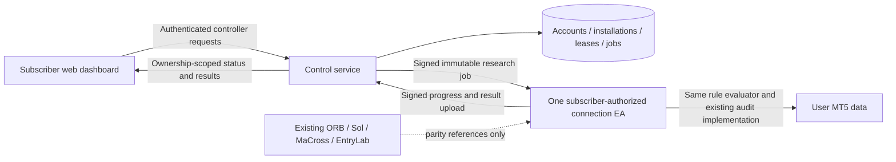

# Stratum: Single-EA Connection Architecture

Status: universal four-engine MT5 adapter and control plane implemented;
public production deployment remains gated. Current verification and limitations
are maintained in `MT5_AUTHORIZATION_VERIFICATION.md`, which supersedes the
early v1 implementation-status table below.
One personalized connection EA is the product boundary. The four production EAs
are reference systems, not four separately deployed customer integrations.

Non-negotiable product requirement: the ONE connection EA must eventually offer
the full functional capacity of EntryLab, MaCross, ORB and SolAdvanced, while
remaining unable to start research or new trading without subscriber authority
issued through the web. The initial v1 wire contract is not the full product.

## 1. Responsibilities



- Web edits user-owned rules and displays results. It does not decide historical
  fills or substitute the synthetic demo for MT5 research.
- Control service owns identity/entitlement checks, pairing, a single active
  controller generation per account, dispatch, revocation, and result ownership.
- One closed-source connection EX5 must evaluate user configurations for audit
  and live operation. A passive current-signal listener alone cannot backtest.
- Customer configuration is data, not executable MQL, Python, shell, or uploaded
  arbitrary code. Proprietary house strategy recipes are not exposed.
- The customer artifact can use one generic binary plus a personalized signed
  authorization manifest. Personalized naming or recompiling a shared secret
  into EX5 is not the authorization mechanism.

### Full-Capacity Runtime, Not A Passive Listener

| Existing capability | Universal EA responsibility |
|---|---|
| EntryLab builder | Independent BUY/SELL/exit logic, indicator periods, comparisons, logical operators, stateful primitives |
| MaCross | All existing entry kernels, parameterization and signal timing |
| ORB-like user engines | Session/timezone/range/breakout primitives sufficient to build equivalent user-owned engines |
| Sol-like user engines | FVG, sweep, displacement and liquidity-state primitives sufficient for equivalent user-owned engines |
| Shared filters | NAS Entry/State/OPP/ADD, two volume streams, regimes, OF and other applicable filters |
| Trade policies | Pip/R geometry, inversion, spread limits, independent caps, reverse waits, daily limits, time matrix |
| Research | Existing exact-data audit, cache reuse, trade rows, costs, progress and feature export |
| Operation | Position ownership/recovery, risk/balance/margin checks and licensed native execution |
| Strategy/model management | Complete settings persistence and applicable model-filter selection; external training remains a separate authorized job |

This is a preservation requirement, NOT a list of features already ported into a
new EX5. Reuse the proven implementations behind narrow runtime adapters; do not
ship four EA programs or independently rewrite four calculation engines. House
recipes remain private; the builder exposes validated primitives rather than
secret strategy definitions. New stateful primitives require explicit semantics
and parity tests, not merely more enum names in the request schema.

### Standalone Denial And Subscription Lifecycle

- Without a valid installation binding, entitlement, scoped lease and authorized
  configuration, the generic EX5 remains in standby. OnInit must not start an
  audit automatically; OnTick must not open orders merely because a chart exists.
- Central permission guards must cover ALL entry points: normal/inverse entry,
  re-entry, native orders, publication, backtest start/resume, model/CSV research
  and cached-result access. A local dashboard toggle cannot bypass these guards.
- The web sends configuration and authority; local EA evaluation is not a cloud
  signal-per-tick dependency. Licenses refresh outside the hot calculation path.
- Backtest authority and live authority are separate. The universal adapter
  supports explicit Trading ON after a matching complete audit; Apply is never
  a live permission request. Native authority is independently verified in EX5.
- Known subscription expiry bounds every lease. Revocation/connection failure
  blocks new work as soon as observed, and no later than the lease deadline.
- Existing positions retain protective SL/TP and emergency/risk-reducing
  management; expiry must not intentionally strand exposure. This safety path
  cannot be used to add exposure or re-enter without subscription authority.
- Neither copying an EX5 nor possession of an old pairing code is a new grant.
  Local administrator tampering is a residual risk, not something a software
  certificate can absolutely eliminate.

## 2. Implemented Boundaries

| Component | Source | Current state |
|---|---|---|
| Strict versioned request/result contracts | `lib/control-contract.ts` | Implemented and tested |
| Durable local control plane | `control-service/control-plane.mjs`, `schema.sql` | SQLite transactions; implemented |
| Request/job signature helpers | `control-service/crypto.mjs` | SHA-256, Ed25519, protocol-v1 canonical JSON |
| Loopback HTTP API | `control-service/http.mjs` | Auth, origin/host checks, size/rate limits |
| Device protocol client | `control-service/device-client.mjs` | Signature/pin/scope/expiry/generation validation |
| Studio connection UI | `components/connection-panel.tsx` | Real local API; no fake terminal state |
| Development protocol probe | `control-service/device-dev.mjs` | Not an EA; rejects work with `MT5_ADAPTER_NOT_CONNECTED` |
| Subscriber identity and billing | Provider boundary in control plane | Not configured; production startup refused |
| MT5 rule/audit adapter and connection EX5 | `IndicatorCodeExamples/universal` | Four canonical engines bundled; local native verification, public release gated |

The web site remains a static export. The Node control service is a separate
process; adding it does not magically create API routes in the static deployment.
The Sites project currently cannot be opened, so no cloud deployment is claimed.
No production EA, listener, bridge, CSV schema, or broker terminal was changed.

## 3. Pairing And Access

1. The installation generates an asymmetric key pair. The private key never goes
   to the web panel or backend; only its public key is registered.
2. Registration creates a five-minute, one-use pairing code and installation ID.
3. The authenticated owner reviews the installation label and key fingerprint,
   then explicitly approves it. Labels are installation-declared, not attestation.
4. Owner activation creates a fresh controller generation and a 90-second lease.
   The database allows only one current controller row per account.
5. Device heartbeats renew the lease only while the controller session and
   entitlement remain valid. Changing controller cancels previous unfinished jobs.
6. Every device request signs version, installation ID, HTTP method, exact path,
   canonical body hash, real-wall-clock timestamp, and unique nonce. Nonces are
   recorded durably; key copying, signature tampering, and replay are distinct risks.
7. Server job/lease signatures are verified against a pinned server public key,
   not a public key accepted from the same untrusted response.

This is a versioned application proof envelope, NOT a claimed implementation of
the full OAuth DPoP specification. Production subscriber login should use a proven
OIDC/OAuth integration; device enrollment can adopt RFC 8628. A browser header
declaring a user ID is never trusted by this standalone service.

The test service uses an operator-created bearer session. `--local-dev` is explicit,
binding is loopback-only, and production startup is refused. Development keys and
sessions live in ignored `.state/`, never in static assets. That folder is not an
installer and its files are not production-grade device key storage. Windows key
protection/TPM or a tested protected-key helper remains a deployment requirement.

## 4. Immutable Backtest Jobs

Request v1 carries:

- Exact installation, idempotency ID, broker server, symbol and UTC date bounds.
- Independent BUY and SELL condition trees, including AND/OR/XOR/NOT and crosses.
- Indicator operands with period, source, and lag relative to a closed signal bar.
  `lag=0` means the most recently CLOSED bar, never the forming bar.
- Stop distance in pips, target R, single/independent position mode, concurrent
  same-direction cap, and reverse exit wait in minutes.
- Explicit broker UTC offset/DST profile and seven day-hour masks. Mask index is
  Sunday=0 through Saturday=6; bit h permits broker-calendar hour h.
- `real_ticks_only` policy. Approximate data is not silently substituted.

All objects reject unknown fields. Tree depth/node limits, allowed operand names,
finite numeric values, and date ranges are checked before accepting a job. Cross
operators compare this closed bar with the preceding closed bar; a future adapter
must implement this semantics exactly or refuse the configuration.

Canonical normalized configuration and full request are independently hashed.
The signed job includes both hashes, subscriber/installation/generation/attempt,
runtime version, scope, issue/expiry times and `liveTradingAllowed=false`.
Updating dashboard values cannot mutate an already running job.

Job transitions:

```text
queued -> running -> completed
                 -> failed
queued/running   -> cancelled
```

Claims are atomic, one active job is allowed per account, and stale attempts cannot
upload. A timed-out job is not automatically retried, preventing duplicate work.
Exact creation retries are idempotent; changed requests with the same ID conflict.
Exact completed-result retries are idempotent; changed replays conflict.
Revocation/generation changes take effect server-side immediately. Offline local
work can only be stopped when it observes cancellation or its bounded lease
expires; this is not an instantaneous remote kill-switch guarantee.

## 5. MT5 Adaptation: Preserve The Existing Engine

The next vertical slice implements an adapter, not a second backtest engine:

```text
verified job -> validated runtime settings -> existing EntryLab audit
             -> existing trade rows/progress -> signed upload -> web result
```

- Keep one active evaluator for historical and live rules. Map only proven
  supported predicates; reject unsupported/stateful rules rather than silently
  approximating them. The present v1 contract deliberately does not yet contain
  all NAS, OF, inversion, regime, quota, or builder features. Extend it explicitly
  before representing those settings, never drop them in conversion.
- Keep existing geometry, pip-size mapping, Bid/Ask logic, fills, costs, tick
  coverage decisions and cache semantics. Do not reimplement them in the web.
- Native `WebRequest` is synchronous and unavailable inside Strategy Tester.
  For an on-chart audit, a separate connection context/helper can handle network
  work without blocking the evaluator. For Strategy Tester runs, prepare a
  verified local job first and collect output outside the tester. The transport
  choice must be validated before shipping the ONE connection EX5.
- Existing `../scripts/mt5_validation_harness.py` is a reference for automated
  test launches, not a user-facing agent. Reuse narrow proven pieces; do not copy
  its entire research environment or create a terminal per trade.
- Use real wall time for authorization, not historical tester `TimeCurrent` or
  a candle timestamp. Verification/watchdog must sit in the real-time context.
- Correlate all artifacts by job/attempt/hash; write atomically and bound caches.
  No per-trade temporary terminal copies or unbounded `.tmp` output.
- Backtest research must never enter live native/bridge order functions. A later
  live permission is a separate capability, with explicit user activation.

Required parity gate: same settings/data/build must match entry bar, direction,
geometry, exit timestamp/reason, net R and W/L/O/FLAT/DATA rows against the existing
EA. Validate simple and independent cases, restarts, reverse waits, broker offsets,
gaps, costs, and missing coverage. Summary matching alone is insufficient.

## 6. Results And Progress

Progress has explicit phases: preparing, downloading, replaying, uploading.
Unknown download totals remain null. Known progress displays examined/total work,
not an elapsed-time cosmetic animation. Replay totals cannot change mid-phase;
processed work and phase progression cannot move backwards.

Results are capped at 10,000 trade rows in this initial transport and 4 MiB HTTP
bodies. Larger runs need a versioned chunked artifact upload, not truncation.
Trade IDs must be unique; known outcomes require a real exit and consistent net R.
Zero realized R is FLAT, not forced WIN/LOSS. OPEN/DATA use null realized R.
Unknown spread/slippage/commission/swap use null, never an invented zero.

Backend recomputes W/L/O/FLAT/DATA, net R, WR and closed-equity drawdown from rows.
Drawdown is closed-position, not floating/equity/EOD; identical exit timestamps
use a stable trade-ID tie order in v1, not a claim of tick-deal sequencing.
The adapter must provide finer exit ordering before exact tied-event drawdown is
used for acceptance decisions. MT5 ticket lifetime and market prices are not
verified merely by accepting a correctly signed upload.

Coverage carries a dataset fingerprint, real tick count and missing intervals;
generated ticks are forbidden by this policy. CoverageComplete is separate from
jobCompleted. The client reports these facts; a signature establishes origin and
integrity, not the truth of customer-controlled execution.

All results are `client_reported`. Publishing a trusted leaderboard or claiming
verified performance requires a controlled replay against licensed data and the
matching engine build. Authorization does not solve overfitting or fill accuracy.

## 7. Local API

| Method | Path | Authorization |
|---|---|---|
| GET | `/health` | Public, non-secret readiness |
| GET | `/v1/session` | Owner bearer session |
| POST | `/v1/pairings` | Rate-limited public registration |
| POST | `/v1/pairings/review`, `/approve` | Owner + entitlement; fingerprint confirmation |
| POST | `/v1/installations/:id/activate`, `/revoke` | Owner |
| POST / GET | `/v1/jobs` | Owner; creation needs current controller + entitlement |
| GET / POST | `/v1/jobs/:id`, `/:id/cancel` | Owner |
| GET | `/v1/device/pairing` | Device key proof; pending state allowed |
| POST | `/v1/device/heartbeat`, `/claim` | Approved device, active controller and entitlement |
| POST | `/v1/device/progress`, `/result`, `/failure` | Device proof + current generation/attempt |

No database credentials, broker passwords or signing private keys are exposed
to the browser. The browser can request scoped Trading ON/OFF, not submit raw
broker orders. Same-origin HTTPS deployment and genuine
identity/billing verification are required before opening this service remotely.

## 8. Run And Test

From `web-mvp/`:

```powershell
node --experimental-strip-types --test scripts/test-control.mjs
node node_modules/typescript/bin/tsc --noEmit
node --experimental-strip-types control-service/start.mjs --local-dev
# In another terminal, optional development protocol probe:
node --experimental-strip-types control-service/device-dev.mjs pair
node --experimental-strip-types control-service/device-dev.mjs watch
```

Open `/studio`, choose MT5 connection, and use the locally generated access token
from `control-service/.state/dev-access.json`. Review the probe's code/fingerprint,
approve it, and authorize the controller. Inspect/edit the request JSON before
dispatching. The probe will return `MT5_ADAPTER_NOT_CONNECTED`, not fake trades.
Never distribute the development access token, private keys, or `.state` folder.

## 9. Remaining Production Gates

1. Real subscriber identity, verified billing events, revocation/logout and MFA.
2. Tested MQL/transport signature verification and protected installation keys.
3. Generic connection EX5, runtime adapter, and trade-by-trade parity evidence.
   Full-capacity feature/strategy preservation must be checked against ALL four
   reference systems; a small protocol example is not completion of this gate.
4. HTTPS deployment, managed server keys/rotation, persistent multi-user storage,
   external rate limiting, backups, monitoring and recovery/load tests.
5. Large-result artifact upload, cancellation latency and connection-loss policy.
6. Signed installer/package integrity and user-controlled device replacement.

Client-side code cannot provide an unbreakable anti-sharing guarantee against an
administrator controlling the machine. Key binding, leased authority and online
checks raise the barrier; do not market them as hardware attestation or DRM proof.

## Primary References

- [MQL5 WebRequest restrictions](https://www.mql5.com/en/docs/network/webrequest)
- [MT5 automated launch/test configuration](https://www.metatrader5.com/en/terminal/help/start_advanced/start)
- [MT5 real and generated tick behavior](https://www.metatrader5.com/en/terminal/help/algotrading/tick_generation)
- [OAuth device authorization](https://www.rfc-editor.org/info/rfc8628/)
- [OAuth security practice](https://www.rfc-editor.org/rfc/rfc9700.html)
- [DPoP proof-of-possession reference](https://www.rfc-editor.org/info/rfc9449/)
- [Node cryptographic primitives](https://nodejs.org/api/crypto.html)
- [Node SQLite API](https://nodejs.org/api/sqlite.html)
- [Windows DPAPI scope and limitations](https://learn.microsoft.com/en-us/windows/win32/seccrypto/example-c-program-using-cryptprotectdata)
